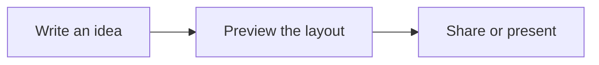

# Introduction to MiaoYan

MiaoYan is a lightweight Markdown notebook, and every note is a plain `.md` file. On the Mac, `⌘3` switches between the source and the typeset page, and `⌘\` puts the source on the left and the page on the right.

## See what it does

A small table:

| To do this | On the Mac, press |
| --- | --- |
| New note | `⌘N` |
| Switch between editing and preview | `⌘3` |
| Open MiaoYan PPT | `⌥⌘P` |

A to-do list, ticked by clicking its boxes in the preview:

- [x] Open MiaoYan
- [ ] Write a first note
- [ ] Put this guide away when done

A diagram:

A formula, the golden ratio:

$$\phi = \frac{1 + \sqrt{5}}{2} \approx 1.618$$

## Three things to try on the Mac

1. Press `⌘N` for a new note, type its title, then press Return to write the body
2. Type `/mermaid` in the body and press `Tab` for a diagram template; `/table`, `/task` and `/fold` work the same way
3. Open "MiaoYan PPT" in this folder and press `⌥⌘P` to see a deck written in Markdown

For more patterns, "MiaoYan Markdown Syntax Guide" has headings, code, diagrams and footnotes.

## Keep writing on iPhone and iPad

The [iPhone and iPad apps](https://apps.apple.com/app/miaoyan/id6759252269) open the same iCloud Drive folder, so notes written on the Mac carry on there. Every note lives in your own folder; see or change where in Settings.

Keyboard shortcuts on the Mac

#### Window Operations

- `⌘1` - Toggle folder sidebar
- `⌘2` - Toggle file list
- `⌘3` - Toggle preview mode
- `⌘4` - Toggle presentation mode
- `⌘5` - Toggle table of contents
- `⌘\` - Toggle split view
- `⌥⌘0` - Show the main window
- `⌥⌘M` - Show/hide MiaoYan globally

#### Document Operations

- `⌘N` - New document
- `⌘R` - Rename document
- `⌘D` - Duplicate document
- `⌘O` - Open a file or folder in Single Mode
- `⌘⌫` - Move document to Trash
- `⇧⌘N` - New folder
- `⇧⌘L` - Auto-format
- `⌥⌘R` - Show in Finder
- `⌥⌘I` - Show document properties
- `⌥⌘P` - Launch PPT preview

More to know

- Press `⌘5`, or hover the slim handle near the top right in preview, for the table of contents; any note with two or more headings gets one
- `Format > Tab Quick Input` lists every template; built in are `/time`, `/table`, `/img`, `/video`, `/markmap`, `/mermaid`, `/plantuml`, `/fold`, `/task`
- After pasting plain text, `⇧⌘L` tidies headings, lists and blank lines
- Return inside a list or to-do item continues it; Return twice goes back to a plain paragraph
- MiaoYan PPT works on notes with `---` separators; Return shows the outline and `Esc` leaves. See the [Reveal](https://revealjs.com/markdown/) docs for more

## Why MiaoYan

After trying many note apps (WizNote, Evernote, Ulysses, Quiver, MWeb, Bear, Typora), I couldn't find a Markdown tool that felt right, so I built MiaoYan.

As a front-end developer with some iOS experience, I wanted to explore Swift and macOS development while creating a tool I'd actually use.

## Done reading

You can [put this guide away](miaoyan://guide/hide): the whole "MiaoYan Guide" folder moves to the Trash, and you can bring it back from there any time.
