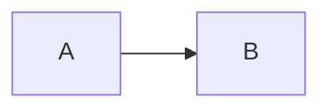

CommonMark is a precise specification of core Markdown, and GitHub Flavored Markdown (GFM) is a strict superset of it that adds tables, task lists, strikethrough, extended autolinks and a filter for a few dangerous HTML tags. Anything beyond that, such as footnotes, math, callouts and diagrams, is an app feature, not a standard. If you want a note to render the same everywhere, stick to CommonMark plus the GFM extensions you have tested. MiaoYan 4.5.0 uses the cmark-gfm parser with four extensions turned on, then adds math, callouts and diagrams in its preview.

## Why there are flavors at all

John Gruber released Markdown in 2004 as a syntax description plus a Perl script, Markdown.pl. According to the [CommonMark site](https://commonmark.org/), the description does not specify the syntax unambiguously, so implementers copied the behavior of Markdown.pl, which was buggy and was last updated in December 2004. By 2014 there were dozens of implementations, and they had drifted apart, and the same file could render differently from one site to the next.

The [CommonMark spec](https://spec.commonmark.org/0.31.2/) fixed that by writing the rules down with examples, and its current version is 0.31.2 (January 2024). The [GFM spec](https://github.github.com/gfm/) is based on CommonMark and says plainly that GFM is a strict superset of it. Its latest published version is 0.29-gfm from April 2019, so it is a snapshot, not a moving target.

This is the whole story of "flavors". There is a core that is now well specified, a small layer of extensions that GitHub standardized, and a long tail where every app does its own thing.

## What each layer defines

**CommonMark** covers headings, emphasis, lists, block quotes, code spans and fences, links, images, raw HTML, hard and soft line breaks, and backslash escapes. A single newline inside a paragraph is a soft break, which renders as a space; a hard break needs a backslash or two trailing spaces at the end of the line.

**GFM** adds these extensions, each marked as such in its spec:

- Tables, with a header row and a delimiter row of hyphens, optionally with colons for alignment.
- Task list items, written `- [ ]` and `- [x]`.
- Strikethrough with `~~text~~`.
- Extended autolinks, which turn a bare `www.example.com` or `https://example.com` into a link without angle brackets.
- Disallowed raw HTML, which rewrites the opening `<` of `<title>`, `<textarea>`, `<style>`, `<xmp>`, `<iframe>`, `<noembed>`, `<noframes>`, `<script>` and `<plaintext>` to `&lt;` in HTML output.

**App extensions** are everything else. Footnotes, math with dollar signs, `> [!NOTE]` callouts, wikilinks and Mermaid diagrams are all common, and none is in the CommonMark or GFM specifications. GitHub itself documents footnotes and alerts on its own syntax page, but those are GitHub features, not part of the published GFM spec.

## Which layer MiaoYan 4.5.0 implements

MiaoYan renders Markdown with cmark-gfm. In the 4.5.0 source, the parser is created with the footnotes option and four extensions attached by name: `table`, `footnotes`, `strikethrough` and `tasklist`. The rendering call passes the option that lets raw HTML through. Two things follow:

- The extended autolink extension is not attached, so a bare URL is not turned into a link by the parser. Write `<https://example.com>` or a normal link.
- The tagfilter extension is not attached either, so GFM's disallowed raw HTML rule is not applied in the preview. Raw HTML such as a `<details>` block renders, which is what makes collapsible sections work, and it also means you should only open notes you trust.

Before the parser runs, MiaoYan shields math. It protects `$$ ... $$`, `$ ... $`, `\( ... \)` and `\[ ... \]` so that underscores and asterisks in a formula are not read as emphasis; KaTeX typesets them later in the preview. After the parser, a post-processing step turns `> [!NOTE]`, `[!TIP]`, `[!IMPORTANT]`, `[!WARNING]` and `[!CAUTION]` blockquotes into callouts, as GitHub does. The preview's script then draws fenced `mermaid`, `plantuml` and `markmap` blocks and colors code with highlight.js. A leading `---` front matter block is stripped from the preview.

[[figure:commonmark-vs-gfm|Flow from a Markdown note through math shielding, the cmark-gfm parser with four extensions, callout rewriting and a web view that runs KaTeX, the diagram scripts and highlight.js, producing the rendered preview.|The parser handles CommonMark plus tables, footnotes, strikethrough and task lists; math, callouts and diagrams are added before and after it.]]

MiaoYan also has a Line Break setting with two values, MiaoYan and Github. Under the hood this switches between rendering every newline as a line break and rendering a newline as a space, which is the CommonMark rule. The [cheat sheet](/blog/markdown-cheat-sheet/) covers the practical effect.

Wikilinks (`[[Project plan]]`) are indexed by MiaoYan to build backlinks; see [Wikilinks and backlinks](/blog/wikilinks-and-backlinks/). They are not in CommonMark or GFM, so a renderer that does not implement them shows the literal brackets.

## Writing portable Markdown

Portable means the file reads well as plain text and renders the same in the apps you actually use. A few habits get most of the way.

1. Use fenced code blocks with a language word, not indentation.
2. Put a blank line before and after lists, tables and code fences.
3. Use `-` for bullets and a lowercase `x` in task items.
4. Write a URL as `<https://example.com>` or `[text](url)`, never as a bare address.
5. End a line with a backslash when you need a hard break, since trailing spaces are invisible and often stripped.
6. Treat footnotes, math, callouts and diagrams as extensions. If the note must be read in a plain viewer, keep the key information outside them.
7. Avoid raw HTML except where the receiving app is known to allow it.

When a feature is app-specific, decide whether losing it is acceptable. A callout that falls back to a block quote with `[!NOTE]` in it is fine for a personal note and a poor choice for a README.

## A test file for any app

Paste this into a new note in the app you are checking, then compare the preview with the list underneath.

````markdown
# Heading
Line one
Line two

| a | b |
|---|---|
| 1 | 2 |

- [x] done
- [ ] open

~~struck~~ and www.example.com and <https://example.com>

Footnote[^1]

[^1]: The note.

> [!NOTE]
> A callout.

Inline $a_1 + b_1$ and a block:

$$
x^2 + y^2 = z^2
$$


````

Read the result like this. Two lines joined into one means the app follows the CommonMark soft break rule, two lines kept apart means it breaks at every newline. If the table or the task boxes appear as text, the app lacks the GFM extension. The `www.example.com` link tells you about extended autolinks. A block quote that still shows `[!NOTE]` has no callouts. Literal dollar signs mean no math, and a code block showing the Mermaid source means no diagrams.

In MiaoYan 4.5.0, expect the table, task boxes and strikethrough to render, `www.example.com` to stay plain text, the footnote, callout, math and diagram to render, and the two lines to join or separate depending on the Line Break setting.

## How other tools differ

GitHub renders the GFM spec and its [documented syntax](https://docs.github.com/en/get-started/writing-on-github/getting-started-with-writing-and-formatting-on-github/basic-writing-and-formatting-syntax) adds footnotes and the five alert types; the GFM spec itself notes that GitHub also post-processes and sanitizes the HTML. Other editors each choose their own extensions and change them between releases, so the test file above is the reliable way to learn what a given tool does. For choosing an editor, see [Choosing a Markdown editor for Mac](/blog/markdown-editor-for-mac/).

## FAQ

### Is GFM the same as CommonMark?

No. GFM contains all of CommonMark and adds the extensions listed above, so a valid CommonMark note is valid GFM, but not the other way round.

### Why does my table show as plain text?

The table extension needs a header row and a delimiter row with the same number of cells. An app that only implements CommonMark will never render it.

### Does MiaoYan support footnotes and math?

Yes in 4.5.0. Footnotes come from the parser, math from KaTeX in the preview. See [LaTeX math in Markdown](/blog/latex-math-in-markdown/).
