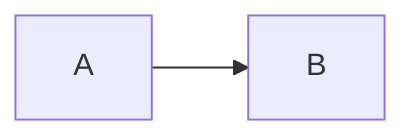

CommonMark 是对 Markdown 核心语法的一份精确规范，GitHub Flavored Markdown（GFM）是它的严格超集，多出了表格、任务列表、删除线、扩展自动链接，以及对几个危险 HTML 标签的过滤。再往外的脚注、公式、提示框、图表这些都是各个应用自己的功能，不在任何标准里。想让一篇笔记到哪都渲染一致，就只用 CommonMark 加上你实测过的 GFM 扩展。妙言 4.5.0 用的是 cmark-gfm 解析器，打开了四个扩展，然后在预览里另外加上公式、提示框和图表。

## 为什么会有这么多方言

John Gruber 在 2004 年发布 Markdown，当时是一份语法说明加一个 Perl 脚本 Markdown.pl。按 [CommonMark 官网](https://commonmark.org/)的说法，这份说明并没有把语法写得没有歧义，实现者只好照着 Markdown.pl 的行为来，而它有不少 bug，最后一次更新是 2004 年 12 月。到 2014 年已经有几十种实现，各家渐渐跑偏，同一个文件换个网站渲染就可能不一样。

[CommonMark 规范](https://spec.commonmark.org/0.31.2/)把规则连同大量示例写了下来，当前版本是 2024 年 1 月的 0.31.2。[GFM 规范](https://github.github.com/gfm/)以它为基础，并明确写了 GFM 是 CommonMark 的严格超集，最新发布的版本是 2019 年 4 月的 0.29-gfm，是一个快照，不是一直在动的目标。

所谓方言大致就是这三层，一个现在已经定义清楚的核心，GitHub 标准化的一小批扩展，以及每个应用各玩各的长尾。

## 每一层定义了什么

**CommonMark** 管标题、强调、列表、引用块、行内代码和围栏代码块、链接、图片、原始 HTML、软硬换行和反斜杠转义。段落里单独一个换行是软换行，渲染成一个空格，想硬换行要在行尾加反斜杠或者两个空格。

**GFM** 在规范里标明的扩展有这几项。

- 表格，需要表头行和由连字符组成的分隔行，冒号用来指定对齐。
- 任务列表项，写成 `- [ ]` 和 `- [x]`。
- 删除线 `~~text~~`。
- 扩展自动链接，裸写的 `www.example.com` 或 `https://example.com` 不加尖括号也会变成链接。
- 禁用的原始 HTML，输出 HTML 时把 `<title>`、`<textarea>`、`<style>`、`<xmp>`、`<iframe>`、`<noembed>`、`<noframes>`、`<script>`、`<plaintext>` 开头的 `<` 改成 `&lt;`。

**应用扩展**就是其余的一切。脚注、美元符号公式、`> [!NOTE]` 提示框、双链、Mermaid 图表都很常见，但没有一个写在 CommonMark 或 GFM 规范里。GitHub 自己的语法文档里写了脚注和提示框，那是 GitHub 的功能，不属于已发布的 GFM 规范。

## 妙言 4.5.0 实现到哪一层

妙言用 cmark-gfm 渲染 Markdown。4.5.0 的源码里，解析器带着脚注选项创建，并按名字挂了四个扩展，`table`、`footnotes`、`strikethrough` 和 `tasklist`，输出 HTML 时用的是允许原始 HTML 通过的选项，由此带来两点。

- 扩展自动链接没有挂上，所以裸 URL 不会被解析器变成链接，要写 `<https://example.com>` 或者普通链接。
- tagfilter 也没有挂，GFM 的禁用原始 HTML 规则在预览里不生效，`<details>` 这样的原始 HTML 会正常渲染，折叠段落能用就靠这个，同时也意味着只打开你信得过的笔记。

解析之前，妙言会先保护公式，`$$ ... $$`、`$ ... $`、`\( ... \)` 和 `\[ ... \]` 里的下划线和星号不会被当成强调，预览里再由 KaTeX 排版。解析之后有一步后处理，把 `> [!NOTE]`、`[!TIP]`、`[!IMPORTANT]`、`[!WARNING]`、`[!CAUTION]` 这五种引用块变成提示框，和 GitHub 的写法一致。预览页的脚本再把围栏里的 `mermaid`、`plantuml`、`markmap` 画出来，用 highlight.js 给代码上色，文件开头的 `---` front matter 在预览里会被去掉。

[[figure:commonmark-vs-gfm|Markdown 笔记依次经过公式保护、带四个扩展的 cmark-gfm 解析器、提示框改写，再由运行 KaTeX、图表脚本和 highlight.js 的网页视图生成预览。|解析器负责 CommonMark 加表格、脚注、删除线和任务列表，公式、提示框和图表是在它前后额外加的。]]

妙言设置里还有一项「换行方式」，两个选项是「妙言」和「Github」，底层是在「每个换行都当成换行」和「换行当成空格」之间切换，后者就是 CommonMark 的规则，实际效果在[语法速查](/zh/blog/markdown-cheat-sheet/)里有讲。

妙言会索引双链（`[[项目计划]]`）来生成反向链接，见[双链与反向链接](/zh/blog/wikilinks-and-backlinks/)，双链不在 CommonMark 或 GFM 里，没实现的渲染器会把方括号原样显示。

## 怎么写出可移植的 Markdown

可移植的意思是文件当纯文本读也顺，在你会用到的应用里渲染一致，几个习惯就够用了。

1. 代码用带语言名的围栏，不用缩进。
2. 列表、表格和代码围栏前后各留一个空行。
3. 无序列表用 `-`，任务项里的 x 用小写。
4. URL 写成 `<https://example.com>` 或 `[文字](链接)`，不要裸写。
5. 要硬换行就在行尾加反斜杠，行尾空格看不见，很多编辑器保存时还会去掉。
6. 把脚注、公式、提示框和图表当成扩展，笔记要在纯文本查看器里读的话，关键信息别只放在它们里面。
7. 除非确认对方应用允许，尽量不用原始 HTML。

用到应用专有功能时先想一下丢掉它能不能接受，提示框退化成带 `[!NOTE]` 的引用块，对自己的笔记没关系，放进 README 就不太合适。

## 用一个测试文件检查任何应用

把下面这段贴进要检查的应用里新建的笔记，对照后面的说明看预览。

````markdown
# Heading
Line one
Line two

| a | b |
|---|---|
| 1 | 2 |

- [x] done
- [ ] open

~~struck~~ and www.example.com and <https://example.com>

Footnote[^1]

[^1]: The note.

> [!NOTE]
> A callout.

Inline $a_1 + b_1$ and a block:

$$
x^2 + y^2 = z^2
$$


````

结果这样读。两行连成一行说明应用遵循 CommonMark 的软换行规则，两行分开说明它在每个换行处断行；表格或任务框显示成文字，说明缺 GFM 扩展；`www.example.com` 有没有变成链接，能看出有没有扩展自动链接；引用块里还显示着 `[!NOTE]`，说明没有提示框；美元符号原样出现，说明没有公式渲染；代码块里显示 Mermaid 源码，说明没有图表渲染。

在妙言 4.5.0 里，表格、任务框和删除线会渲染，`www.example.com` 保持纯文本，脚注、提示框、公式和图表会渲染，两行是连起来还是分开取决于换行方式设置。

## 其他工具有什么不同

GitHub 渲染 GFM 规范，它的[语法文档](https://docs.github.com/en/get-started/writing-on-github/getting-started-with-writing-and-formatting-on-github/basic-writing-and-formatting-syntax)另外写了脚注和五种提示框，GFM 规范本身也说明 GitHub 在转成 HTML 之后还会做后处理和净化。

别的编辑器各自挑扩展，版本间也会变，所以想知道某个工具到底怎么样，上面的测试文件最可靠。选编辑器的话看 [Mac 上怎么选 Markdown 编辑器](/zh/blog/markdown-editor-for-mac/)。

## 常见问题

### GFM 和 CommonMark 是一回事吗？

不是。GFM 包含全部 CommonMark，再加上上面列的扩展，所以合法的 CommonMark 笔记也是合法的 GFM，反过来不成立。

### 为什么我的表格显示成纯文本？

表格需要表头行和单元格数相同的分隔行，只实现 CommonMark 的应用永远不会渲染它。

### 妙言支持脚注和公式吗？

4.5.0 支持，脚注由解析器处理，公式在预览里由 KaTeX 排版，见 [Markdown 里写 LaTeX 公式](/zh/blog/latex-math-in-markdown/)。
