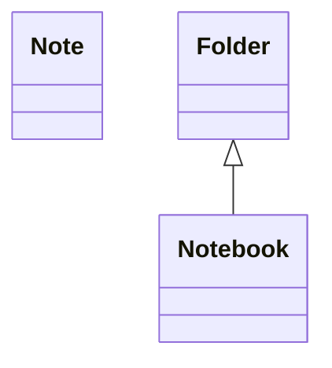
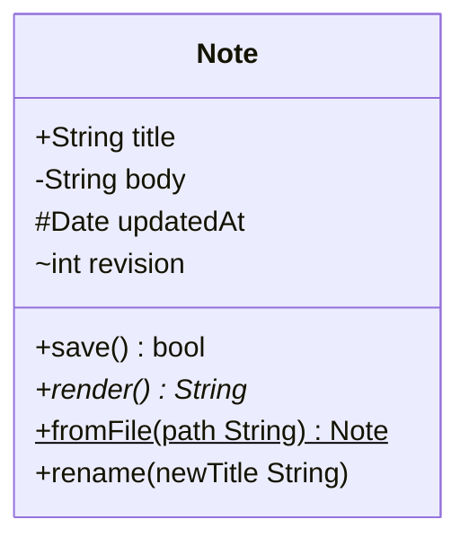
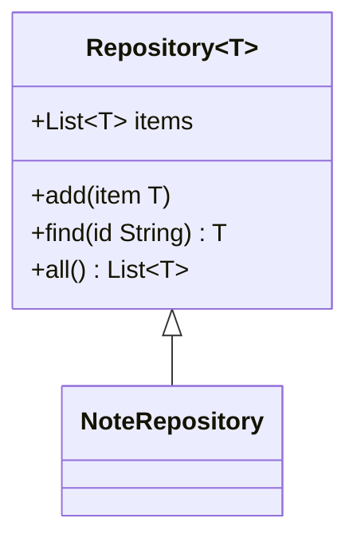
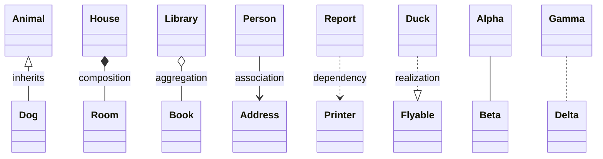
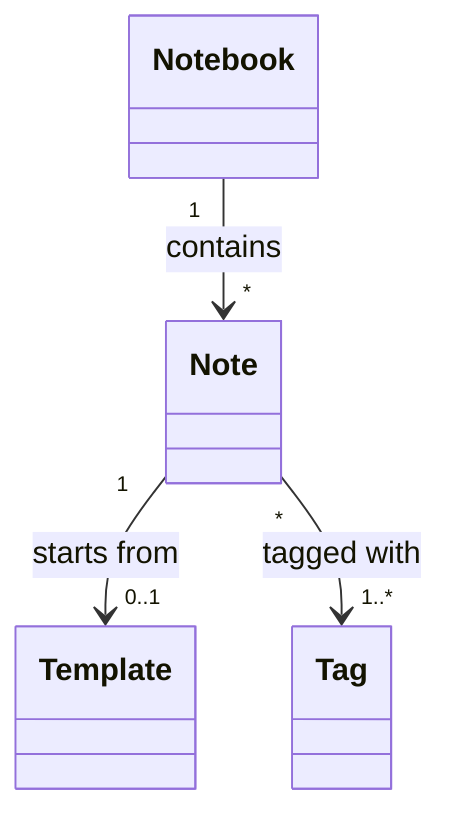
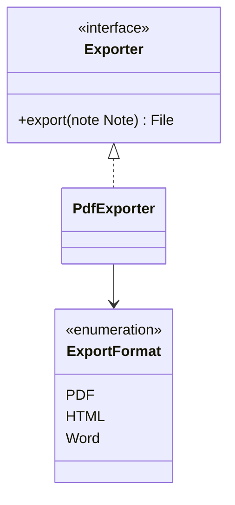
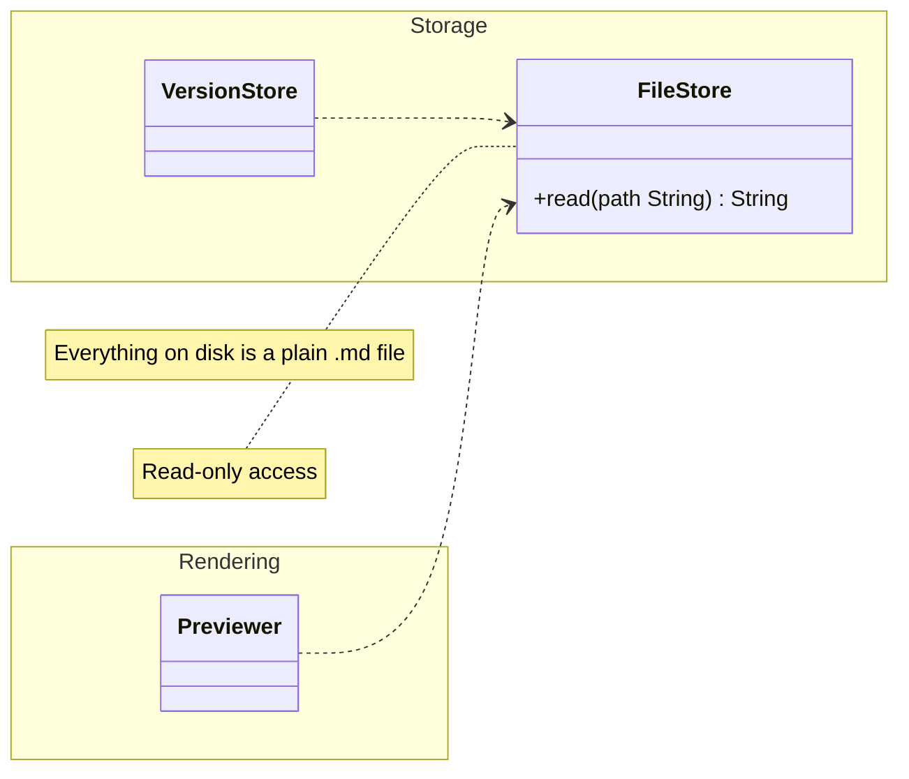
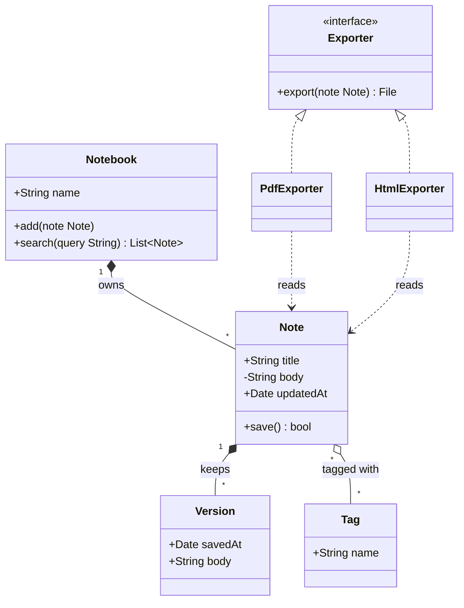

To draw a class diagram in Markdown, open a fenced code block tagged `mermaid`, start it with `classDiagram`, declare classes with `class Name`, and connect them with arrows such as `<|--` for inheritance and `*--` for composition. A Mermaid-aware preview turns the text into an SVG. MiaoYan V4.9.0 bundles Mermaid 11.14.0 and runs it offline, so everything below works without a network connection. Two newer features, namespace labels and nested namespaces, arrived in Mermaid 11.15.0 and are left out here.

## Declare a class

````markdown

````

A class exists as soon as you name it, either with `class Note` or by appearing in a relationship such as `Folder <|-- Notebook`. The Mermaid documentation says a class name should use only letters, digits, underscores and dashes. For a name with spaces or punctuation, either give the class a label with `class Note["Note with a label"]` or wrap the name in backticks.

## Members and methods

There are two ways to add members, and the result is the same. One is a colon after the class name, one member per line. The other is a block in curly brackets.

````markdown

````

Mermaid decides whether a line is an attribute or a method by looking for parentheses. A line with `()` is a method, and anything else is an attribute. The four visibility marks go in front of the name:

| Mark | Meaning |
|------|---------|
| `+` | Public |
| `-` | Private |
| `#` | Protected |
| `~` | Package or internal |

A method can end with a return type, and the documentation requires a space between the closing parenthesis and the type, as in `save() bool`. After the parentheses or the return type, `*` marks the method abstract and `$` marks it static. A field can end with `$` to mark it static, as in `String instances$`. In the sample above, `render()*` is abstract and `fromFile(...)$` is static.

## Generics

Wrap a generic type in tildes instead of angle brackets, because `<` and `>` belong to arrows and annotations.

````markdown

````

Nested generics such as `List~List~int~~` work. The documentation says a generic that contains a comma, such as `Map~K, V~`, is not supported, so avoid it even though 11.14.0 draws a simple case. The type parameter is not part of the class name, so `Repository` and `Repository~T~` name the same class, and two classes with the same name and different parameters cannot coexist in one diagram.

## Relationships

The syntax is `ClassA <arrow> ClassB`, and the arrow can point the other way, so `A <|-- B` and `B --|> A` mean the same thing.

| Arrow | Relationship | Usual UML reading |
|-------|--------------|-----------------|
| `<\|--` | Inheritance | B is a kind of A |
| `*--` | Composition | A owns B, and B ends with A |
| `o--` | Aggregation | A holds B, and B can live on its own |
| `-->` | Association | A refers to B |
| `..>` | Dependency | A uses B briefly |
| `..\|>` | Realization | A implements the interface B |
| `--` | Link (solid) | A is connected to B |
| `..` | Link (dashed) | A is loosely connected to B |

````markdown

````

Text after a colon becomes a label on the line. Two-way relations combine a head, a link and another head, for example `Animal <|--|> Zebra`. The last column is UML convention, not something Mermaid checks: it only draws the arrow you wrote, and picking the right one is yours.

## Cardinality

Put the count in double quotes next to the class, on the side of the arrow it belongs to.

````markdown

````

The documentation lists `1`, `0..1`, `1..*`, `*`, `n`, `0..n` and `1..n`, and any quoted text is accepted, such as `"many"`.

## Annotations

An annotation is a marker in double angle brackets that says what kind of class this is. The documentation lists `<<Interface>>`, `<<Abstract>>`, `<<Service>>` and `<<Enumeration>>` as common ones, but any text works.

````markdown

````

You can also write the annotation on its own line after the class, as in `<<interface>> Exporter`, or inline, as in `class Exporter <<interface>>`.

## Namespaces, notes and direction

`namespace` groups classes into a labelled box.

````markdown

````

`note "text"` puts a free note on the diagram and `note for ClassName "text"` attaches one to a class. The documentation uses `\n` for a line break inside a note, but 11.14.0 prints it as is, so use `<br>` instead. `direction` takes `TB`, `BT`, `LR` or `RL` on its own line, usually right after `classDiagram`. Comments start with `%%` and must sit on their own line. Namespaces and notes cannot be styled one by one, though they follow the theme.

## A worked example: a small note app

The classes below model a note app's domain. A notebook owns its notes, a note refers to tags and keeps versions, and exporters implement one interface.

````markdown

````

Version uses composition because a version has no meaning without its note. Tag uses aggregation because a tag outlives any one note. Exporters depend on Note briefly and do not hold it, so they get a dashed arrow.

## How it renders in MiaoYan

A fenced block with the `mermaid` tag reaches the preview as a code element with a `language-mermaid` class. A script in the preview finds those elements and calls the bundled Mermaid library, which turns the text into SVG and replaces the code. The preview configures Mermaid's theme colors for light or dark appearance and caches the SVG for each pair of appearance and source text. For the other diagram types and the offline behavior, see [Mermaid diagrams in Markdown](/blog/mermaid-diagrams-in-markdown/).

To try it, type `/mermaid` and press `Tab`. MiaoYan inserts a `graph LR` template, and you can replace its contents with `classDiagram` and your classes. Press `⌘3` for the preview or `⌘\` for the split view and watch the diagram update as you type.

## What goes wrong

- **The block stays as code.** MiaoYan keeps the fenced source when Mermaid fails to parse it and shows no error message. Bisect by deleting lines until it renders.
- **A method shows up as an attribute.** Without parentheses it is an attribute, so add `()`.
- **A feature from the live documentation fails.** The site documents the newest Mermaid. Namespace labels and nested namespaces need 11.15.0, newer than the 11.14.0 in MiaoYan V4.9.0, so `namespace Core["Core layer"]` or a namespace inside a namespace is a parse error and the block stays as code. A newer diagram type may be missing too.
- **A very large model is unreadable.** Split it by namespace into several diagrams. If you prefer PlantUML's class syntax, [PlantUML in Markdown](/blog/plantuml-in-markdown/) covers it, with the caveat that it needs a network connection.

## FAQ

### What is the difference between composition and aggregation?

Both mean "has". In composition (`*--`) the part cannot exist without the whole, like a version of a note. In aggregation (`o--`) the part can exist on its own, like a tag. Mermaid only draws a filled diamond for one and a hollow one for the other.

### How do I show an interface?

Use an annotation, `<<interface>>`, and connect implementers with `..|>`. A lollipop notation, `bar ()-- foo`, also exists for a short interface marker.

### Can I draw an enum?

Yes, with the `<<enumeration>>` annotation and one value per line inside the class block, as in the `ExportFormat` sample above.
