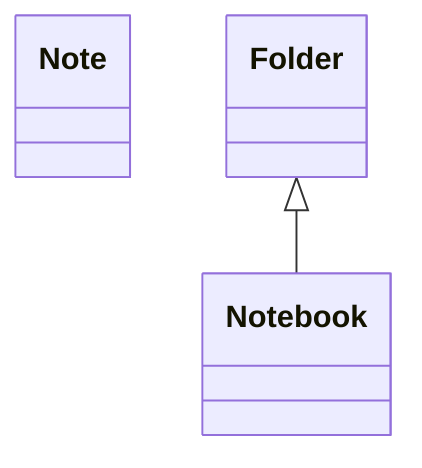
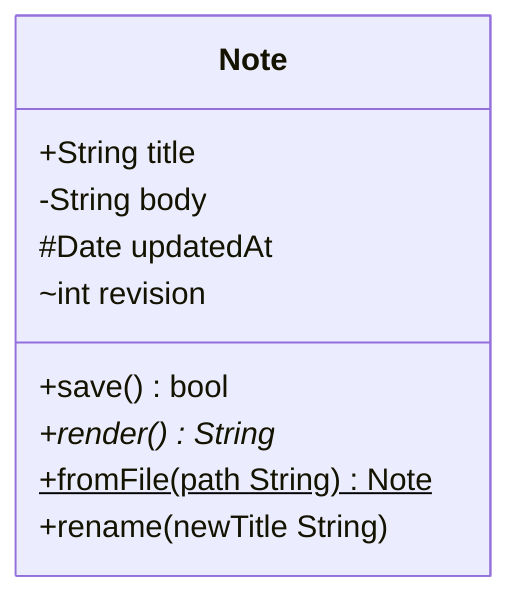
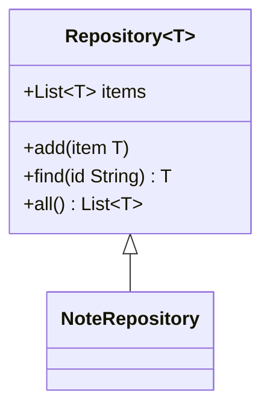
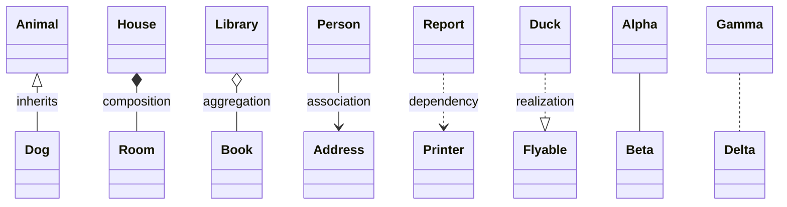
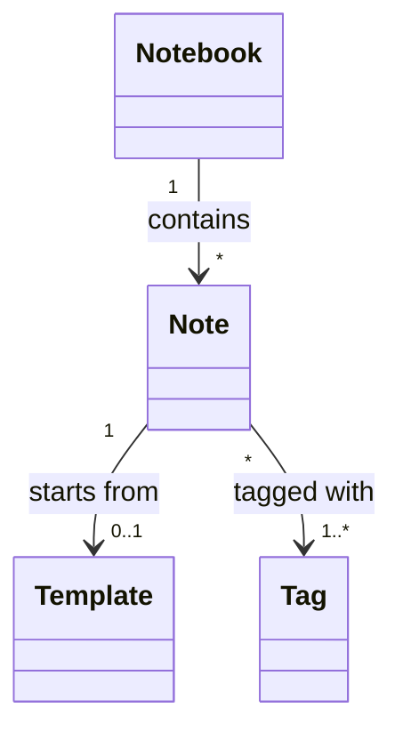
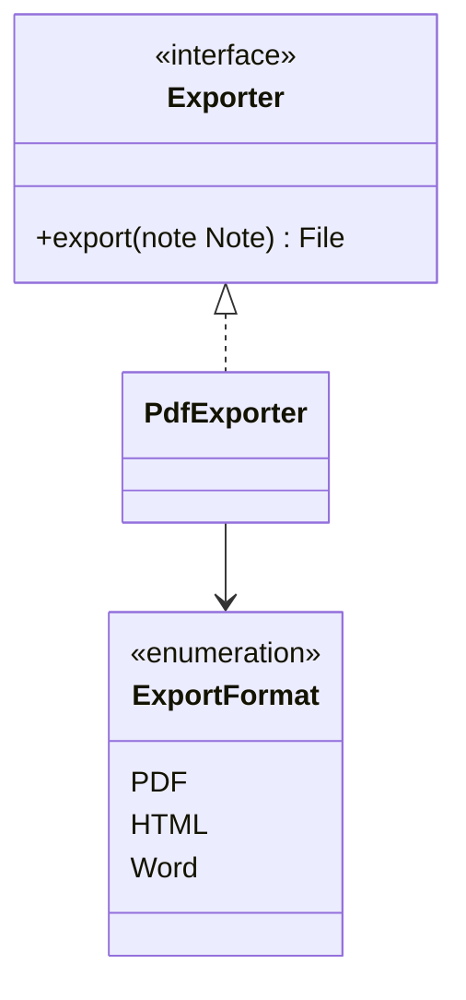
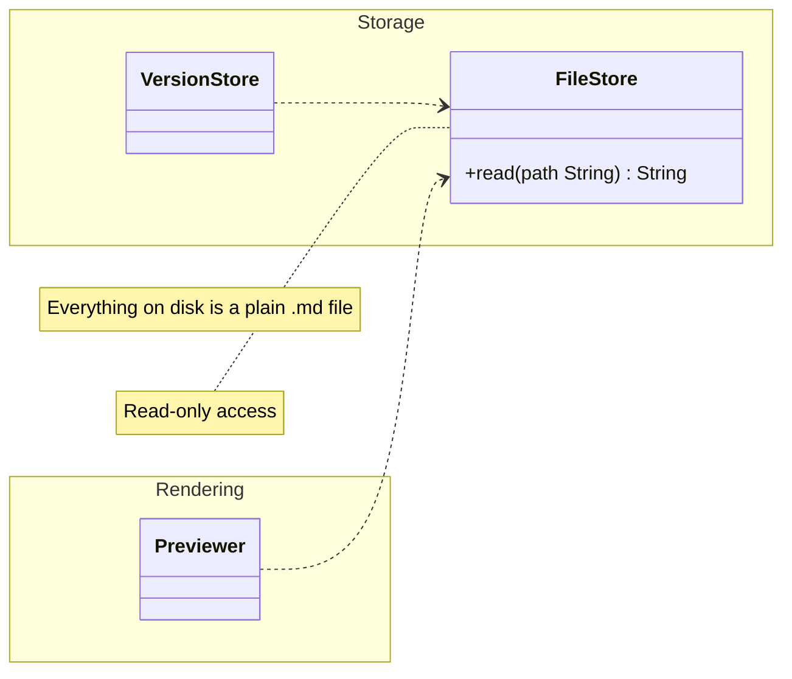
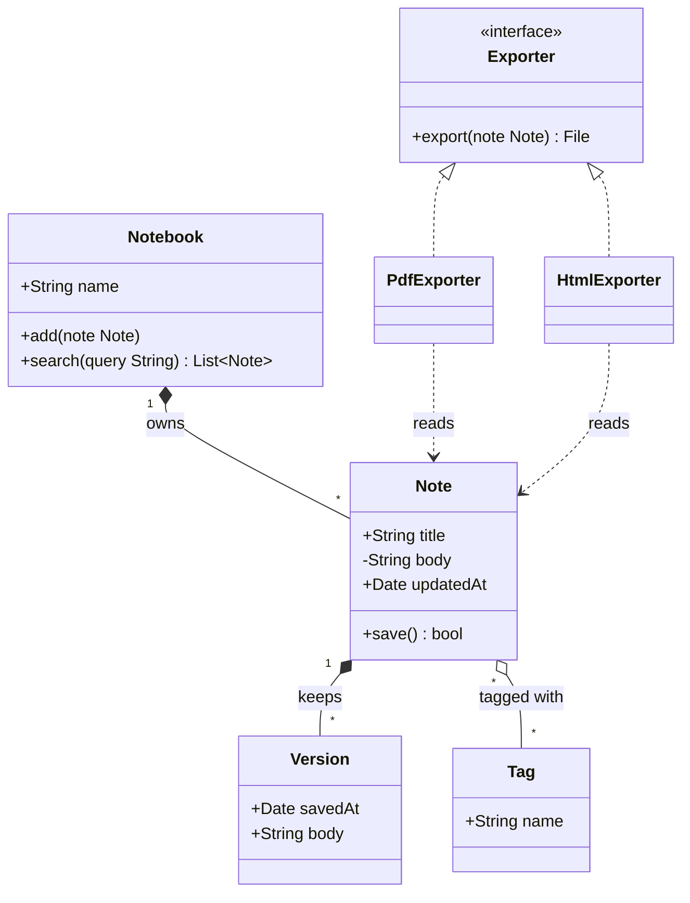

在 Markdown 里画类图，做法是开一个语言名为 `mermaid` 的围栏代码块，第一行写 `classDiagram`，用 `class 类名` 声明类，再用 `<|--` 表示继承、`*--` 表示组合这类箭头把它们连起来，支持 Mermaid 的预览会把文字渲染成 SVG。妙言 V4.9.0 自带 Mermaid 11.14.0 并且离线运行，所以下面的写法都不需要联网。命名空间的显示标签和嵌套命名空间是 Mermaid 11.15.0 才有的，这篇不涉及。

## 声明一个类
````markdown

````

一个类只要写了名字就存在了，可以用 `class Note` 声明，也可以直接出现在 `Folder <|-- Notebook` 这样的关系里。Mermaid 文档说类名只应包含字母、数字、下划线和短横线，名字里要带空格或标点时，可以用 `class Note["Note with a label"]` 给类加一个显示标签，或者用反引号把名字括起来。

## 属性和方法

加成员有两种写法，结果一样，一种是在类名后面加冒号，一行一个成员，另一种是用花括号写成一个块。
````markdown

````

Mermaid 靠有没有括号区分属性和方法，带 `()` 的是方法，其余都当属性。可见性符号写在名字前面，一共四个。

| 符号 | 含义 |
|------|------|
| `+` | 公开 |
| `-` | 私有 |
| `#` | 受保护 |
| `~` | 包内可见 |

方法后面可以接返回类型，文档要求右括号和类型之间必须有一个空格，写成 `save() bool`。写在括号或返回类型之后的 `*` 表示抽象方法，`$` 表示静态方法，字段末尾也可以加 `$` 表示静态，比如 `String instances$`。上面的例子里 `render()*` 是抽象方法，`fromFile(...)$` 是静态方法。

## 泛型

泛型用波浪线包起来，不用尖括号，因为 `<` 和 `>` 已经被箭头和注解占用了。
````markdown

````

嵌套泛型比如 `List~List~int~~` 可以用，带逗号的泛型比如 `Map~K, V~` 文档写明目前不支持，11.14.0 虽然能画出简单的情况，也别依赖它。类型参数不算类名的一部分，所以关系里写 `Repository` 和 `Repository~T~` 指的是同一个类，同一张图里也不能有两个名字相同、类型参数不同的类。

## 关系

写法是 `ClassA <箭头> ClassB`，箭头方向可以反过来，`A <|-- B` 和 `B --|> A` 是一回事。

| 箭头 | 关系 | UML 里的常见读法 |
|------|------|----------|
| `<\|--` | 继承 | B 是 A 的一种 |
| `*--` | 组合 | A 拥有 B，A 没了 B 也没了 |
| `o--` | 聚合 | A 持有 B，B 可以独立存在 |
| `-->` | 关联 | A 引用 B |
| `..>` | 依赖 | A 临时用到 B |
| `..\|>` | 实现 | A 实现接口 B |
| `--` | 实线连接 | A 和 B 有联系 |
| `..` | 虚线连接 | A 和 B 有松散的联系 |
````markdown

````

冒号后面的文字会成为连线上的标签，双向关系是头、线、头拼在一起，比如 `Animal <|--|> Zebra`。表里最后一列是 UML 的惯例，Mermaid 不会替你检查，你写什么箭头它就画什么，用哪个由你决定。

## 数量关系

把数量写进双引号，放在类名旁边、箭头对应的那一侧。
````markdown

````

文档列出的写法有 `1`、`0..1`、`1..*`、`*`、`n`、`0..n` 和 `1..n`，引号里写别的文字也行，比如 `"many"`。

## 注解

注解是双尖括号里的一个标记，用来说明这个类是什么种类，文档列出的常见写法有 `<<Interface>>`、`<<Abstract>>`、`<<Service>>` 和 `<<Enumeration>>`，写别的文字也可以。
````markdown

````

注解也可以单独写一行放在类后面，比如 `<<interface>> Exporter`，或者写在声明行里，比如 `class Exporter <<interface>>`。

## 命名空间、注释和方向

`namespace` 把几个类圈进一个带名字的框里。
````markdown

````

`note "文字"` 在图上放一条自由注释，`note for 类名 "文字"` 把注释挂到某个类上，文档用 `\n` 在注释里换行，但 11.14.0 会把它原样显示出来，要换行改用 `<br>`。`direction` 可以取 `TB`、`BT`、`LR` 或 `RL`，单独写一行，一般紧跟在 `classDiagram` 后面。代码注释用 `%%` 开头并且必须独占一行。命名空间和注释没法单独设样式，但会跟着主题走。

## 一个小笔记应用的完整例子

下面的类描述一个笔记应用的领域模型，笔记本拥有笔记，笔记引用标签并保留历史版本，几种导出器实现同一个接口。
````markdown

````

关系是这样选的，Version 用组合，因为版本离开笔记就没有意义，Tag 用聚合，因为标签不会随某一条笔记消失，导出器只是临时依赖 Note、并不持有它，所以用虚线箭头。

## 在妙言里怎么渲染

带 `mermaid` 标记的围栏块到预览里是一个 `language-mermaid` 类的 code 元素，预览里的脚本找到这些元素，调用自带的 Mermaid 库把文字变成 SVG 替换掉代码，同时按浅色或深色外观设置 Mermaid 的主题颜色，并且按外观和源文本各缓存一份 SVG。其他图表类型和离线行为见[在 Markdown 里画 Mermaid 图](/zh/blog/mermaid-diagrams-in-markdown/)。

想试一下的话，输入 `/mermaid` 再按 `Tab`，妙言会插入一个 `graph LR` 模板，把内容换成 `classDiagram` 和你的类就行，按 `⌘3` 看预览，按 `⌘\` 开分栏，边写边看图更新。

## 出了问题怎么查

- **代码块一直是代码。** Mermaid 解析失败时妙言会保留围栏里的原文，也不会弹出错误信息，可以逐行删掉内容二分查找出错的那一行。
- **方法显示成了属性。** 没有括号就当属性，补上 `()`。
- **在线文档里的写法报错。** 官网文档对应最新的 Mermaid，命名空间标签和嵌套命名空间需要 11.15.0，比妙言 V4.9.0 自带的 11.14.0 新，所以 `namespace Core["Core layer"]` 或者命名空间里再套命名空间都会解析失败，代码块保持原样，更新的图表类型也可能没有。
- **模型太大看不清。** 按命名空间拆成几张图。如果更习惯 PlantUML 的类图写法，见 [Markdown 里的 PlantUML](/zh/blog/plantuml-in-markdown/)，它需要联网。

## 常见问题

### 组合和聚合有什么区别？

两个都是「拥有」，组合（`*--`）里部分离开整体就不存在，比如笔记的版本，聚合（`o--`）里部分可以独立存在，比如标签，Mermaid 只是一个画实心菱形、一个画空心菱形。

### 接口怎么画？

用 `<<interface>>` 注解，再用 `..|>` 连接实现它的类，也有 `bar ()-- foo` 这种棒棒糖写法，用来画一个简短的接口标记。

### 枚举能画吗？

能，用 `<<enumeration>>` 注解，在类块里一行写一个取值，见上面的 `ExportFormat`。
