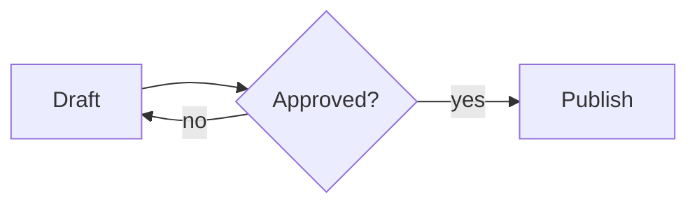
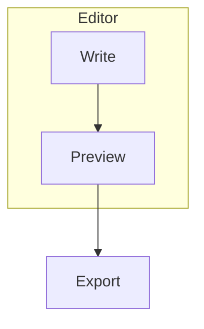
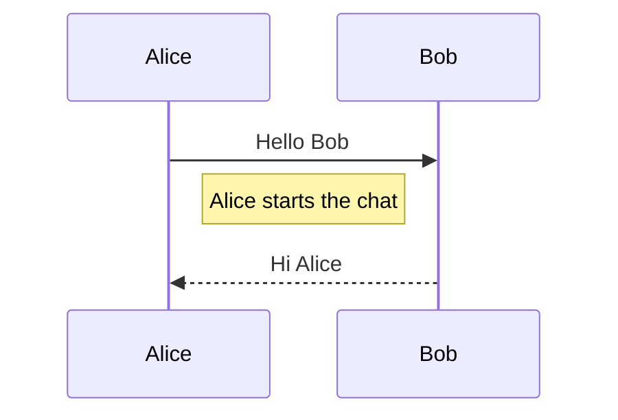
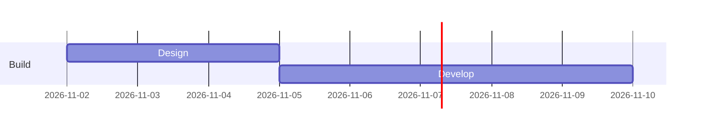
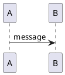

To draw a diagram in Markdown, put its text description inside a fenced code block tagged `mermaid`, and a Mermaid-aware preview renders it as an SVG image. The same approach works for PlantUML and Markmap, each with its own language tag. Mermaid and Markmap run from JavaScript bundled in MiaoYan, so they work offline. PlantUML does not: MiaoYan sends the diagram text to the public plantuml.com server, which matters if the diagram is private.

## Flowcharts

````markdown

````

The first line sets the diagram type and direction. `TD` or `TB` runs top to bottom, `LR` left to right, and `BT` and `RL` reverse those. `graph` works as a synonym for `flowchart`. A bare word is a node with a box shape. `Review{Approved?}` makes a diamond, and other shapes such as rounded boxes, circles and cylinders have their own bracket forms listed in the Mermaid flowchart documentation. `-->|yes|` puts a label on the line.

Group nodes with a `subgraph` block that closes with `end`:

````markdown

````

The Mermaid documentation warns that a node whose text is the lowercase word `end` breaks the chart. Write `End` or `END` instead.

## Sequence diagrams

````markdown

````

`->>` is a solid line with an arrowhead and `-->>` is a dotted one, which is the usual way to show a reply. `participant X as Name` gives a short id a readable label. Notes are placed with `Note right of`, `left of` or `over`, as in the Mermaid sequence-diagram documentation.

## Gantt charts

````markdown

````

`dateFormat` specifies how dates in task lines are formatted, and the Mermaid documentation gives `YYYY-MM-DD` as the default. Each `section` groups tasks. A task line is a title, a colon, then metadata such as an id, a start date or `after <id>`, and a duration. Dates in the example are illustrative.

## PlantUML and Markmap as alternatives

Mermaid covers flowcharts, sequence diagrams, Gantt charts, class diagrams and more, with concise syntax. PlantUML has a longer history with UML, and its syntax is more verbose. Choose it when you already have PlantUML sources or need a UML construct Mermaid draws poorly.

````markdown

````

Markmap is different. It turns an ordinary Markdown outline into an interactive mind map, using the heading and list hierarchy as branches.

````markdown
```markmap
# Release plan
- Design
  - Wireframes
- Build
  - Editor
  - Preview
```
````

Use Markmap to brainstorm a tree structure. Use Mermaid when relationships between boxes matter, such as who calls whom or what follows what.

In MiaoYan you do not have to remember the fences. Type `/mermaid`, `/plantuml` or `/markmap` and press `Tab` to insert a template, or open the Format menu and choose Tab Quick Input.

## How it actually works

A fenced block with a language tag is just text to the Markdown parser, which emits an HTML code element with a `language-mermaid` class. After the page loads, a script in the preview looks for those classes. For Mermaid it calls the bundled library to turn the text into SVG and replaces the code block. For Markmap it renders into the same spot using the bundled Markmap and d3 files. For PlantUML it encodes the text into a URL and sets that as an image source pointing to `https://www.plantuml.com/plantuml/svg/`, so the image comes from that server.

That last step affects privacy. Because the text travels in the URL, anything in the diagram, such as internal service names, leaves your Mac when the preview renders. PlantUML documentation says you can run your own server, but MiaoYan hardcodes the public address into the preview script, with no setting to change it. For private architecture diagrams, use Mermaid.

The preview also adapts the diagram colors to light or dark appearance, and it caches rendered Mermaid SVG by diagram text.

## What goes wrong and how to check

- **The diagram stays as code.** For Mermaid, a syntax error is the usual cause. MiaoYan keeps the original fenced source in place when rendering fails and does not inject an error message into the page, so an unrendered code block is the indicator. Paste the source into the Mermaid live editor or compare it with the documentation.
- **A flowchart breaks on one node.** Check for the lowercase word `end`, unbalanced brackets, or special characters inside a label. Quote the label if needed, for example `A["Cost (USD)"]`.
- **PlantUML shows "Failed to load diagram" and then the code.** The server was unreachable or you are offline. MiaoYan falls back to the source text.
- **Markmap looks empty.** The block needs at least a heading or a list. The root is usually the first `# ` heading.
- **A big diagram is unreadable.** Split it. Two small diagrams explain more than one with forty nodes.

A quick test is to insert `/mermaid` plus `Tab`, switch to preview with `⌘3` or split mode with `⌘\`, and confirm that three connected boxes appear. Then disconnect Wi-Fi, reload, and confirm Mermaid still renders while PlantUML does not.

## Limits

Mermaid's rendering depends on the version bundled in the app, and the version string is not recorded in the app's manifest, so newer diagram types may be missing. Check a new type with a small example before building on it. PlantUML needs a network connection. Exports to HTML, PDF and image come from the preview, so verify an exported file once if diagrams matter. For deck use, all three diagram types are initialized in presentation mode, covered in [Markdown to slides](/blog/markdown-to-slides/).

Related reading: the [Markdown cheat sheet](/blog/markdown-cheat-sheet/) for the fence syntax and [LaTeX math in Markdown](/blog/latex-math-in-markdown/) for formulas. MiaoYan is on the [App Store](https://apps.apple.com/app/id6759252269), and its source is at [github.com/tw93/MiaoYan](https://github.com/tw93/MiaoYan).

## FAQ

### Can I draw a diagram without a network connection?

Yes, with Mermaid or Markmap in MiaoYan. PlantUML needs the public server.

### Which should I learn first?

Mermaid. It has the broadest coverage with the shortest syntax, and many Markdown tools render it, including VS Code's built-in preview.

### Do other editors render the same fences?

Often. Typora lists Mermaid, flowchart.js and sequence diagrams, and VS Code's built-in preview renders `mermaid` blocks. PlantUML and Markmap support varies, so check before moving a note.
