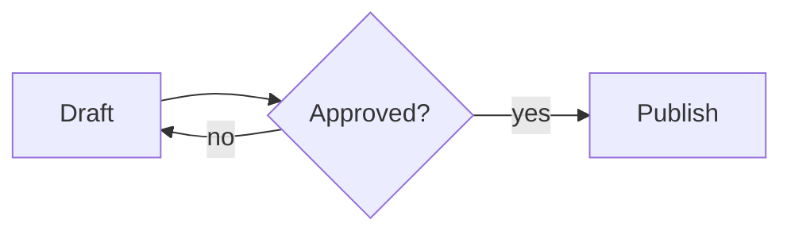
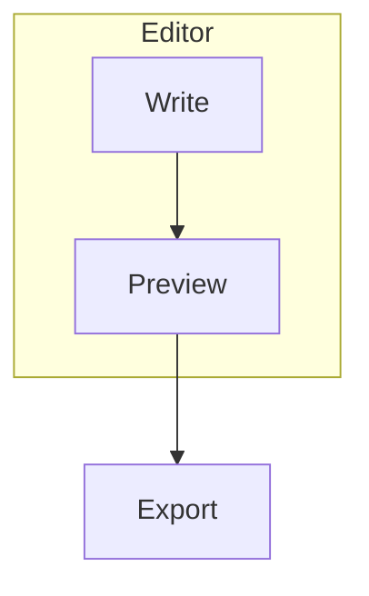
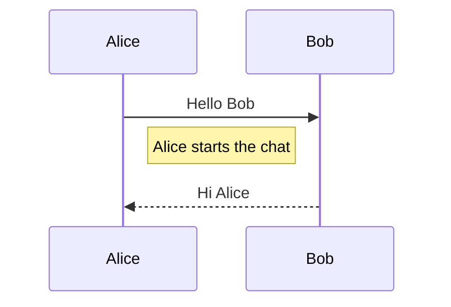
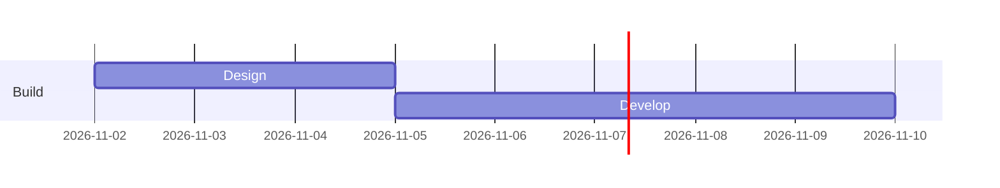
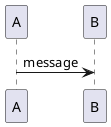

在 Markdown 里画图，做法是把图的文字描述放进语言名为 `mermaid` 的围栏代码块，支持 Mermaid 的预览会把它渲染成 SVG 图片，PlantUML 和 Markmap 的思路一样，各自用自己的语言名。妙言里 Mermaid 和 Markmap 跑的是随应用打包的 JavaScript，所以离线也能用，PlantUML 不行，它会把图的文字发到公共的 plantuml.com 服务器去渲染，图如果是私密的，这一点要先想清楚。

## 流程图

````markdown

````

第一行指定图的类型和方向，`TD` 或 `TB` 是从上到下，`LR` 是从左到右，`BT` 和 `RL` 是反方向，`graph` 可以当 `flowchart` 的同义词。单独一个词就是一个方框节点，`Review{Approved?}` 会画成菱形，圆角框、圆形、圆柱等其他形状各有括号写法，列在 Mermaid 的流程图文档里，`-->|yes|` 是给连线加标签。

用 `subgraph` 块把节点分组，以 `end` 结尾。

````markdown

````

Mermaid 文档提醒，节点文字如果是小写的 `end` 会让整张图出错，要写成 `End` 或 `END`。

## 时序图

````markdown

````

`->>` 是带箭头的实线，`-->>` 是带箭头的虚线，通常用来表示回复。`participant X as Name` 给简短的 id 配一个好读的名字，备注用 `Note right of`、`left of` 或 `over` 放置，写法见 Mermaid 的时序图文档。

## 甘特图

````markdown

````

`dateFormat` 说明任务行里日期的写法，Mermaid 文档给出的默认值是 `YYYY-MM-DD`，每个 `section` 把任务分组，任务行是标题、冒号，再接 id、起始日期或 `after <id>`、时长这样的元数据，示例里的日期只是示意。

## PlantUML 和 Markmap 作为补充

Mermaid 覆盖流程图、时序图、甘特图、类图等，语法也更简短。PlantUML 在 UML 上历史更久，语法更啰嗦，手上已经有 PlantUML 源文件，或者需要 Mermaid 画不好的某种 UML 结构时选它。

````markdown

````

Markmap 不太一样，它把普通的 Markdown 大纲变成可交互的思维导图，标题和列表的层级就是分支。

````markdown
```markmap
# Release plan
- Design
  - Wireframes
- Build
  - Editor
  - Preview
```
````

想梳理一棵树的时候用 Markmap，关心方框之间谁调用谁、谁接着谁的时候用 Mermaid。

妙言里不用背这些围栏，输入 `/mermaid`、`/plantuml` 或 `/markmap` 再按 `Tab` 就会插入模板，也可以在菜单栏的格式里选 Tab快捷输入。

## 它实际是怎么工作的

带语言名的围栏块对 Markdown 解析器来说只是文本，会输出一个带 `language-mermaid` 类名的 HTML code 元素。页面加载完以后，预览里的脚本去找这些类名，Mermaid 就调用打包的库把文本变成 SVG 并替换掉代码块，Markmap 用打包的 Markmap 和 d3 文件渲染在同一个位置，PlantUML 则是把文本编码进一个网址，作为图片地址指向 `https://www.plantuml.com/plantuml/svg/`，图片是从那台服务器取回来的。

最后这一步是要特别留意的。文本是放在网址里传出去的，图里的任何内容，比如内部服务的名字，在预览渲染的时候都会离开你的 Mac。PlantUML 官方文档说可以自建服务器，但我在妙言的源码里看到公共地址是直接写在预览脚本里的，没有找到可以更改它的设置。私密的架构图就用 Mermaid。

预览还会让图的配色跟随浅色或深色外观，并且按图的文本缓存渲染好的 Mermaid SVG。

## 出问题怎么查

- **图一直显示成代码。** Mermaid 的话多半是语法错误，妙言在渲染失败时会把原始围栏源码留在原位，不会往页面里塞错误信息，所以看着像普通代码的块就是信号，可以把源码贴到 Mermaid 在线编辑器里，或者对着文档检查。
- **流程图被某个节点搞坏。** 检查有没有小写的 `end`、括号不配对，或者标签里有特殊字符，必要时给标签加引号，比如 `A["Cost (USD)"]`。
- **PlantUML 先显示 Failed to load diagram 然后显示代码。** 服务器连不上或者处于离线状态时，妙言会退回显示源码文本。
- **Markmap 是空的。** 块里至少要有一个标题或一个列表，根节点通常是第一个 `# ` 标题。
- **大图看不清。** 拆开，两张小图比一张四十个节点的图讲得更清楚。

快速测试一下，输入 `/mermaid` 再按 `Tab`，按 `⌘3` 切到预览或按 `⌘\` 打开分栏，确认出现三个相连的方框，再断开 Wi-Fi 重新加载，确认 Mermaid 还在渲染而 PlantUML 不再渲染。

## 限制

Mermaid 的效果取决于应用打包的版本，而版本号没有记录在应用的清单里，所以较新的图类型可能缺失，要用新类型之前先拿一个小例子试。PlantUML 需要网络。HTML、PDF 和图片导出都来自预览，图表重要的话导出后要核对一次，PDF 怎么分页见[在 Mac 上把 Markdown 转成 PDF](/zh/blog/markdown-to-pdf-mac/)。做演示文稿时三种图表在演示模式里都会初始化，见 [Markdown 转幻灯片](/zh/blog/markdown-to-slides/)。

相关阅读有讲围栏语法的 [Markdown 语法速查](/zh/blog/markdown-cheat-sheet/) 和讲公式的 [Markdown 里写 LaTeX 公式](/zh/blog/latex-math-in-markdown/)。妙言在 [App Store](https://apps.apple.com/app/id6759252269) 上，源码在 [github.com/tw93/MiaoYan](https://github.com/tw93/MiaoYan)。

## 常见问题

### 没有网络能画图吗

在妙言里用 Mermaid 或 Markmap 可以，PlantUML 需要公共服务器。

### 先学哪个

先学 Mermaid，覆盖面最广、语法最短，包括 VS Code 内置预览在内的很多 Markdown 工具都能渲染。

### 别的编辑器能渲染同样的围栏吗

大多都可以，Typora 官网列了 Mermaid、flowchart.js 和时序图，VS Code 内置预览能渲染 `mermaid` 块，PlantUML 和 Markmap 的支持各家不一，搬笔记之前先确认。
