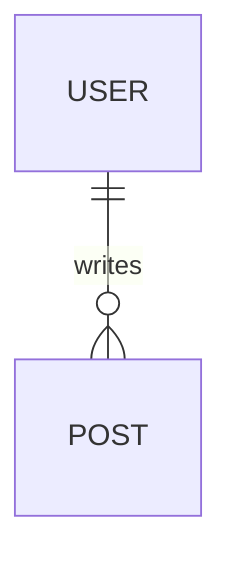
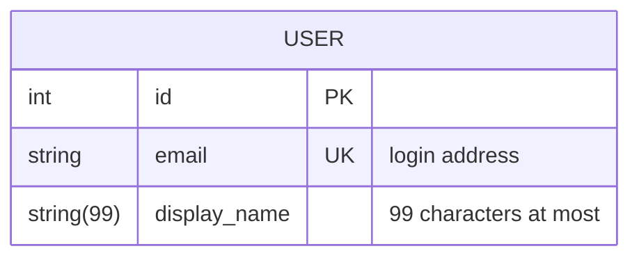
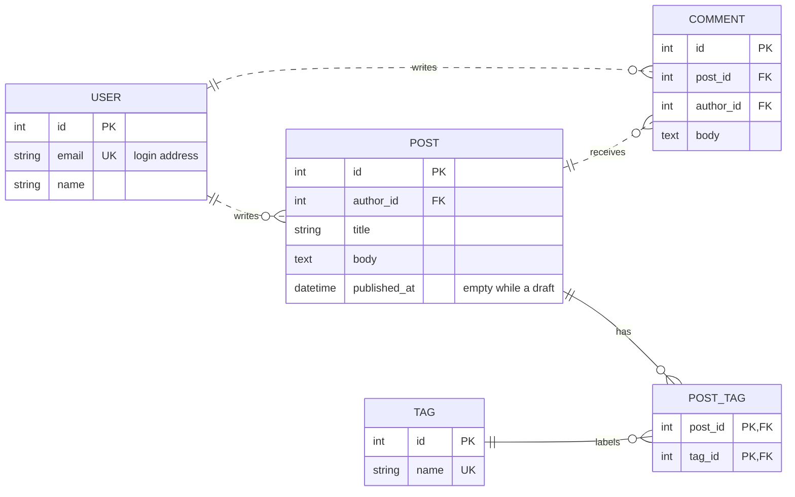
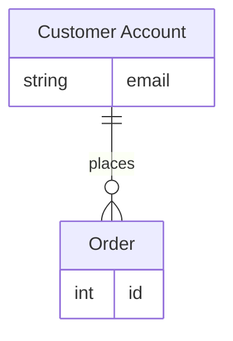

A Mermaid ER diagram is a fenced code block tagged `mermaid` that starts with `erDiagram`, then one line per relationship such as `USER ||--o{ POST : writes`. The two markers beside the entity names are crow's foot cardinalities (`||` exactly one, `o{` zero or more), `--` or `..` sets a solid or dashed line, and a block in curly braces under an entity lists its attributes with type, name, an optional `PK`, `FK` or `UK` key and a quoted comment. This post covers the ER syntax that Mermaid 11.14.0 understands with one worked blog schema; the other diagram types are in [Mermaid in Markdown](/blog/mermaid-diagrams-in-markdown/).

## The smallest ER diagram

````markdown

````

A relationship statement has the form `<first-entity> <relationship> <second-entity> : <label>`. Only the first entity is mandatory, so a line with just `USER` draws a lone entity, but once you add anything after it, every part (relationship, second entity and label) is required. Entities are created the first time their names appear. Names are conventionally singular nouns, usually in capitals, though Mermaid does not require capitals. A name can contain Unicode, and a name with spaces must be wrapped in double quotes, as in `"order item"`.

## Reading the cardinality markers

Each side of the relationship has a two-character crow's foot marker. The character touching the entity is the maximum, and the one toward the line is the minimum. The marker on a side describes the entity on that side: how many of it can relate to one of the other entity.

| Meaning | Left of the line | Right of the line |
| --- | --- | --- |
| Zero or one | `\|o` | `o\|` |
| Exactly one | `\|\|` | `\|\|` |
| Zero or more | `}o` | `o{` |
| One or more | `}\|` | `\|{` |

So `USER ||--o{ POST` reads as: one user (exactly one) has zero or more posts. If a user must have at least one post, write `USER ||--|{ POST`.

If the symbols are hard to remember, Mermaid also accepts words in their place. `one or more`, `one or many`, `many(1)` and `1+` all mean one or more; `zero or more`, `zero or many`, `many(0)` and `0+` mean zero or more; `zero or one` and `one or zero` mean zero or one; `only one` and `1` mean exactly one. They sit where the symbols would, so `USER 1 to zero or more POST : writes` is the same as `USER ||--o{ POST : writes`.

The label is written from the first entity's point of view. Mermaid does not support labels from both perspectives, so pick the direction that reads best, such as `USER writes POST` rather than `POST is written by USER`. Quote a label that contains spaces, for example `: "tagged with"`. Unquoted, Mermaid 11.14.0 keeps only the first word as the label and draws the rest as an extra entity.

## Identifying and non-identifying lines

The line between the two markers is `--` or `..`.

| Symbol | Meaning | Drawn as |
| --- | --- | --- |
| `--` | Identifying | Solid line |
| `..` | Non-identifying | Dashed line |

An identifying relationship means the child cannot be identified without the parent: a row in a join table whose primary key is made of two foreign keys is the classic case. A non-identifying one means the child has its own identity and merely refers to the parent, as a post refers to its author. The words `to` and `optionally to` are accepted for the same two lines. The choice changes only how the line is drawn.

## Attributes, keys and comments

Put curly braces after an entity name and list attributes one per line as `type name`:

````markdown

````

Types must begin with a letter and may contain digits, hyphens, underscores, parentheses and square brackets, so `string(99)` and `string[]` are fine. Mermaid has no fixed list of valid types and does not validate them. After the name you may add one or more keys from `PK` (primary key), `FK` (foreign key) and `UK` (unique key), separated by commas, such as `PK, FK` for a column that is both. A quoted comment goes last and cannot itself contain a double quote. Foreign keys are optional: the Mermaid page says to leave them out of a logical model because the relationships already show the links, and even for physical tables it leaves the choice to you.

## A worked example: a blog schema

Users write posts and comments, posts receive comments, and posts and tags are many to many through a join table.

````markdown

````

The join table `POST_TAG` is the one identifying relationship pair, drawn solid, because its primary key is built from the two parents. Everything else is dashed. A post has zero or more tags and a tag labels zero or more posts, and the join table is what makes that many to many. For a conceptual diagram, `POST }o--o{ TAG : "tagged with"` says the same thing in one line.

## Aliases, direction and styling

An alias in square brackets after an entity id shows a different text in the diagram. The id stays short for the relationship lines:

````markdown

````

`direction` sets the layout: `TB` (top to bottom, the default), `BT`, `LR` and `RL`. Put it on its own line inside the diagram, as in the blog example.

Styling uses `classDef` and `class`, as in flowcharts. `classDef core fill:#f9f,stroke:#333` defines a class, `class USER,POST core` or `USER:::core` attaches it, and a class named `default` applies to every entity without a class of its own.

## How it actually works

Mermaid does not read your database. Its parser reads the text, builds a list of entities with their attributes and a list of relationships, and then a layout step places the boxes and the crow's foot symbols. Each cardinality marker is read as one fixed token, which is why the characters must be exact: `o}` is not a marker and fails the whole diagram. In MiaoYan the preview finds each code block marked `mermaid` and passes its text to the bundled Mermaid library, which returns an SVG that replaces the code block. This runs from JavaScript shipped inside the app, so ER diagrams render offline.

## What goes wrong

- **The diagram stays as code.** MiaoYan keeps the fenced source on screen when Mermaid raises an error and shows no message, so an unrendered block is the signal. Check the points below, or paste the source into the Mermaid live editor.
- **A relationship line fails.** If you give anything after the first entity, you need the marker, second entity and label. `USER ||--o{ POST` without `: writes` is incomplete.
- **An attribute fails.** Each line needs both a type and a name, so `id PK` alone is wrong; write `int id PK`. Keys are `PK`, `FK` and `UK` only, and a comment cannot contain a double quote.
- **A name with spaces fails.** Quote it: `"order item"`. Quote labels with spaces too.
- **Newer syntax breaks.** The Mermaid documentation also describes optional types written as `string? name` (from 11.16.0) and subgraphs (from 11.17.0), and its page documents version 12 defaults. MiaoYan V4.9.0 bundles 11.14.0, so skip those: a `?` type fails the diagram, and a subgraph does not raise an error but draws `subgraph`, the group name and `end` as extra entity boxes. Expect the preview to look a bit different from the pictures on the Mermaid site.
- **A huge schema is unreadable.** Split it by area, one diagram for accounts and one for content, rather than forty entities in one.

To test a diagram, type `/mermaid` and press `Tab` to insert a template, replace its contents with the ER text, and open the preview with `⌘3` or split mode with `⌘\`. An ER diagram is also easy to keep next to a [Markdown table](/blog/markdown-tables/) of column notes for the details Mermaid cannot hold, and [Markdown to PDF on Mac](/blog/markdown-to-pdf-mac/) covers exporting the result.

## FAQ

### What does `||--o{` mean in a Mermaid ER diagram?

Exactly one on the left, zero or more on the right, joined by a solid identifying line. `USER ||--o{ POST` is one user with any number of posts.

### How do I show a many-to-many relationship?

Draw both sides as zero or more with `}o--o{` for a conceptual view, or add a join table with a one-to-many relationship from each side for a physical schema, as the blog example does.
