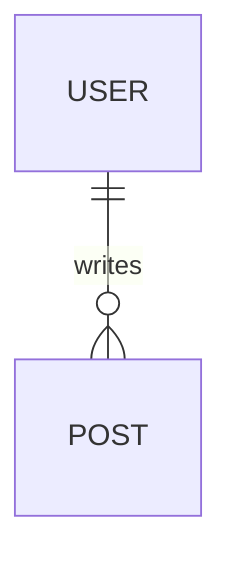
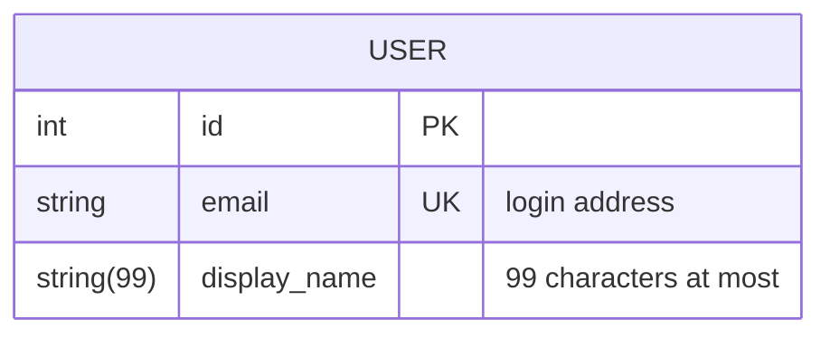
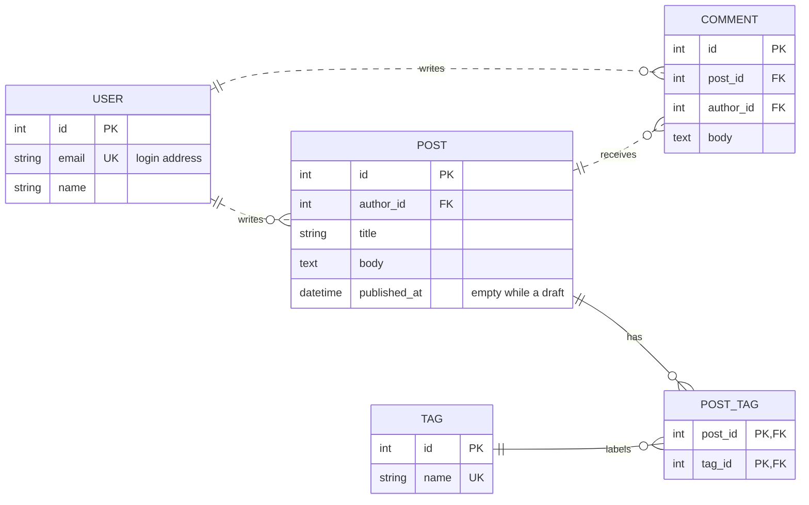
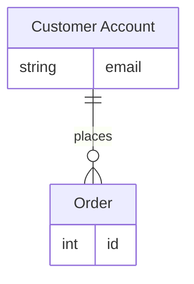

Mermaid 的 ER 图就是一个语言名为 `mermaid` 的围栏代码块，第一行写 `erDiagram`，后面每行描述一个关系，比如 `USER ||--o{ POST : writes`。实体名两侧的符号是鸭脚（crow's foot）基数标记，`||` 是恰好一个，`o{` 是零个或多个，`--` 和 `..` 决定画实线还是虚线，实体名后面用花括号列出属性，每行是类型、名称，可以再跟 `PK`、`FK`、`UK` 键和一段加引号的注释。这篇讲 Mermaid 11.14.0 能认的 ER 语法，并用一个博客数据库做完整例子，其他图类型在 [Markdown 里画 Mermaid 图](/zh/blog/mermaid-diagrams-in-markdown/) 里。

## 最小的 ER 图

````markdown

````

一条关系语句的格式是 `<第一个实体> <关系> <第二个实体> : <标签>`。只有第一个实体是必填的，单独一行 `USER` 会画出一个孤立的实体，但后面只要写了任何东西，关系、第二个实体和标签就必须全都写上。实体在名字第一次出现时创建，名字习惯用单数名词、全大写，不过 Mermaid 并不强制大写。名字可以带 Unicode，带空格的名字要用双引号包起来，比如 `"order item"`。

## 怎么读基数标记

关系线的每一侧各有一个两字符的鸭脚标记，紧贴实体的那个字符是最大值，靠近线的那个是最小值。某一侧的标记描述的是这一侧的实体，也就是对另一个实体的一条记录来说，它可以有几个。

| 含义 | 线左侧 | 线右侧 |
| --- | --- | --- |
| 零个或一个 | `\|o` | `o\|` |
| 恰好一个 | `\|\|` | `\|\|` |
| 零个或多个 | `}o` | `o{` |
| 一个或多个 | `}\|` | `\|{` |

所以 `USER ||--o{ POST` 读作一个用户（恰好一个）有零篇或多篇文章，如果要求每个用户至少有一篇，就写 `USER ||--|{ POST`。

符号记不住的话，Mermaid 也接受用单词代替。`one or more`、`one or many`、`many(1)`、`1+` 都是一个或多个，`zero or more`、`zero or many`、`many(0)`、`0+` 是零个或多个，`zero or one` 和 `one or zero` 是零个或一个，`only one` 和 `1` 是恰好一个。它们放在符号本来的位置，`USER 1 to zero or more POST : writes` 和 `USER ||--o{ POST : writes` 等价。

标签是从第一个实体的角度写的，Mermaid 不支持从两个角度各写一个标签，所以挑读起来顺的那个方向，比如写 `USER writes POST`，不写 `POST is written by USER`。标签里有空格时要加引号，比如 `: "tagged with"`，不加引号的话 Mermaid 11.14.0 只把第一个词当标签，剩下的词会被画成一个多出来的实体。

## 实线和虚线

两个标记之间的线是 `--` 或 `..`。

| 符号 | 含义 | 画成 |
| --- | --- | --- |
| `--` | 识别关系（identifying） | 实线 |
| `..` | 非识别关系（non-identifying） | 虚线 |

识别关系是说子表离开父表就无法确定自己是谁，典型的是主键由两个外键组成的关联表。非识别关系是子表有自己的身份，只是引用了父表，比如文章引用了它的作者。`to` 和 `optionally to` 这两个词也能表示同样的两种线。这个选择只影响线怎么画。

## 属性、键和注释

实体名后面加花括号，每行一个 `类型 名称`：

````markdown

````

类型必须以字母开头，可以包含数字、连字符、下划线、圆括号和方括号，所以 `string(99)` 和 `string[]` 都行。Mermaid 没有固定的类型清单，也不会校验类型。名称后面可以再加一个或多个键，从 `PK`（主键）、`FK`（外键）、`UK`（唯一键）里选，用逗号隔开，既是主键又是外键就写 `PK, FK`。加引号的注释放在最后，注释里自己不能再有双引号。外键是可选的，Mermaid 文档的说法是画逻辑模型时可以不写，因为关系线已经表达了关联，画物理表时写不写也由你自己决定。

## 一个博客数据库的完整例子

用户写文章和评论，文章会收到评论，文章和标签通过一张关联表做多对多。

````markdown

````

关联表 `POST_TAG` 这一对是识别关系，画成实线，因为它的主键由两个父表的键组成，其余都是虚线。一篇文章有零个或多个标签，一个标签标记零篇或多篇文章，多对多就是靠这张关联表实现的。只画概念图的话，一行 `POST }o--o{ TAG : "tagged with"` 就表达了同样的意思。

## 别名、方向和样式

实体 id 后面用方括号写别名，图里显示别名的文字，关系线里仍然用短 id：

````markdown

````

`direction` 控制布局，取值 `TB`（从上到下，默认）、`BT`、`LR` 和 `RL`，单独写一行放在图里，像上面的博客例子那样。

样式和流程图一样用 `classDef` 与 `class`，`classDef core fill:#f9f,stroke:#333` 定义一个类，`class USER,POST core` 或者 `USER:::core` 把它用到实体上，名为 `default` 的类会作用到所有没有自己类的实体。

## 它是怎么工作的

Mermaid 不会去读你的数据库，它的解析器读这段文字，建出一份带属性的实体清单和一份关系清单，再由布局步骤把方框和鸭脚符号摆到位置上。每个基数标记都按一个固定记号来读，所以字符必须写对，`o}` 不是合法标记，整张图都会报错。妙言的预览会找到每个标成 `mermaid` 的代码块，把文字交给随应用打包的 Mermaid 库，库返回一张 SVG 替换掉代码块，这一步跑的是应用里自带的 JavaScript，所以 ER 图离线也能画出来。

## 常见错误

- **图一直是代码。** Mermaid 报错时，妙言会把围栏里的源码原样留着，也不显示错误信息，所以没渲染出来的代码块就是信号，对照下面几条检查，或者把源码贴进 Mermaid 的在线编辑器。
- **一行关系报错。** 第一个实体后面只要写了东西，标记、第二个实体和标签就必须齐全，`USER ||--o{ POST` 少了 `: writes` 就是不完整的。
- **属性报错。** 每行必须同时有类型和名称，单写 `id PK` 是错的，要写成 `int id PK`；键只有 `PK`、`FK`、`UK` 三种，注释里不能有双引号。
- **带空格的名字报错。** 加引号，写成 `"order item"`，带空格的标签也要加引号。
- **新语法不认。** Mermaid 文档里还写了 `string? name` 这种可选类型（11.16.0 起）和子图（11.17.0 起），而且文档页描述的是 12 版的默认外观。妙言 V4.9.0 打包的是 11.14.0，这些都先别用，`?` 类型会让整张图报错，子图倒是不报错，但会把 `subgraph`、分组名和 `end` 画成几个多出来的实体框，预览的样子也会和 Mermaid 官网的图略有不同。
- **图太大看不清。** 按领域拆开，账号一张、内容一张，不要把四十个实体塞进一张图。

测试的办法是输入 `/mermaid` 再按 `Tab` 插入模板，把里面的内容换成 ER 文字，用 `⌘3` 打开预览，或者用 `⌘\` 切到分栏。每列的详细说明 Mermaid 放不下，可以在图旁边配一张 [Markdown 表格](/zh/blog/markdown-tables/)，导出成文件可以看 [Mac 上把 Markdown 转成 PDF](/zh/blog/markdown-to-pdf-mac/)。

## 常见问题

### Mermaid ER 图里的 `||--o{` 是什么意思？

左边恰好一个，右边零个或多个，中间是实线的识别关系。`USER ||--o{ POST` 就是一个用户有任意多篇文章。

### 多对多关系怎么画？

画概念图就两侧都用零个或多个，写成 `}o--o{`；画物理表就加一张关联表，两边各连一条一对多，博客例子就是这样做的。
