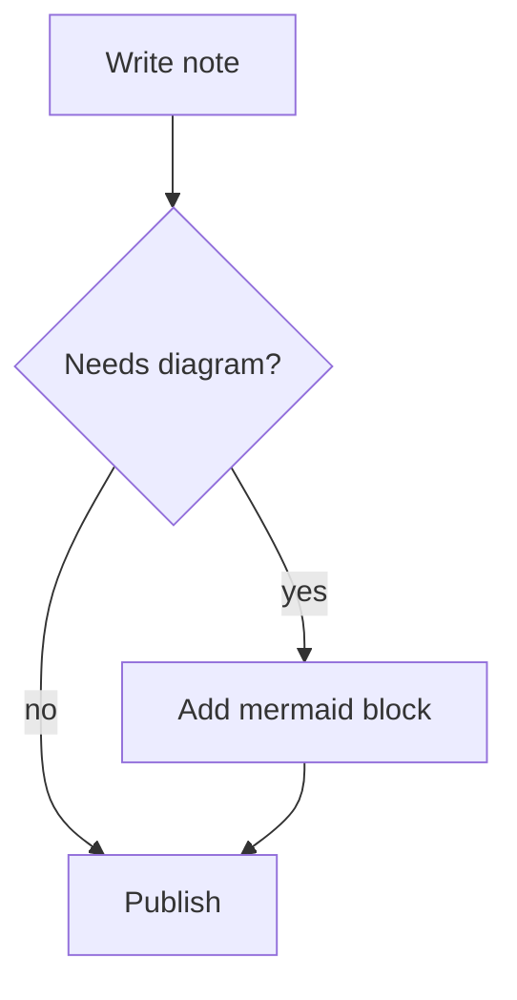
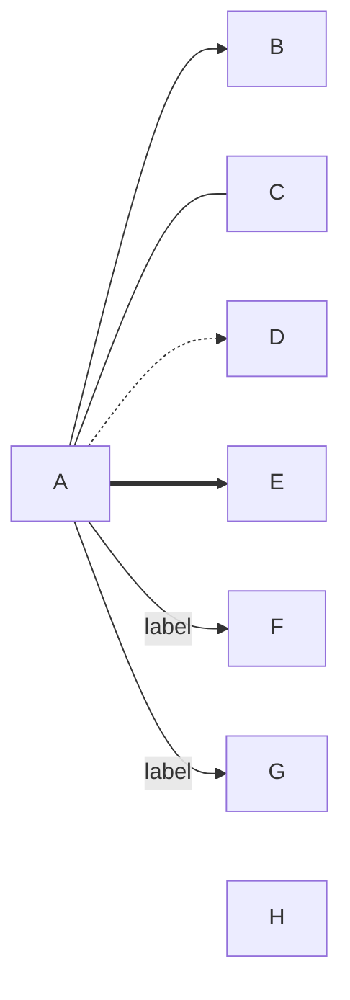
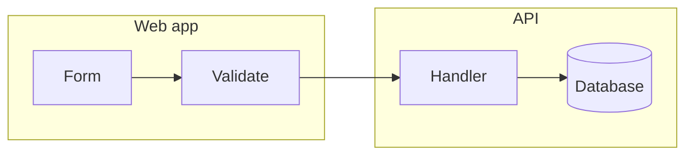
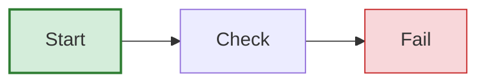

A Mermaid flowchart is a fenced code block tagged `mermaid` whose first line is `flowchart` plus a direction, `TD` for top to bottom or `LR` for left to right, followed by lines like `A[Write] --> B{Done?}`. Square brackets make a box, curly braces make a diamond, `-->|yes|` labels an arrow, and `subgraph ... end` groups nodes. Most failures come from three things: the lowercase word `end`, special characters in labels that need quotes, and a node id that starts with `o` or `x` right after a link. This post goes deep on flowcharts only; [Mermaid in Markdown](/blog/mermaid-diagrams-in-markdown/) covers the other diagram types.

## The smallest flowchart

````markdown

````

The first line is the diagram type and direction. `flowchart` and `graph` both work. Each following line declares nodes and links; a node appears on first use, and later lines reuse its id. In `A[Write note]`, `A` is the id you link to and the bracket text is what is drawn. If you write only `A`, the id is also the label.

## Direction

| Keyword | Flow |
| --- | --- |
| `TD` or `TB` | top to bottom |
| `BT` | bottom to top |
| `LR` | left to right |
| `RL` | right to left |

`TD` and `TB` are the same thing. Choose by shape of the content: a long linear process reads better as `LR` in a wide window, a decision tree with many branches usually fits `TD`. MiaoYan scales a diagram down to fit the preview width, so a long `LR` chart in a narrow pane gets small text; switch to `TD` if that happens.

## Node shapes

The classic syntax picks the shape with brackets around the text:

| Syntax | Shape |
| --- | --- |
| `A[text]` | rectangle |
| `A(text)` | rounded rectangle |
| `A([text])` | stadium (pill) |
| `A[[text]]` | subroutine |
| `A[(text)]` | cylinder, for databases |
| `A((text))` | circle |
| `A(((text)))` | double circle |
| `A{text}` | diamond, for decisions |
| `A{{text}}` | hexagon |
| `A>text]` | asymmetric flag |
| `A[/text/]` and `A[\text\]` | parallelograms |
| `A[/text\]` and `A[\text/]` | trapezoids |

Mermaid 11.3.0 added a second syntax with many more shapes, written as `A@{ shape: cyl, label: "Orders DB" }`. Names include `cyl`, `diam`, `hex`, `doc`, `stadium` and `circle`, each with aliases such as `database` and `decision`. It is verbose, so it earns its place only for shapes the brackets cannot express, such as a document or a stacked rectangle. MiaoYan V4.9.0 bundles Mermaid 11.14.0, so both syntaxes work there. Check the [Mermaid flowchart page](https://mermaid.js.org/syntax/flowchart.html) for the full shape list.

## Edges, labels and chaining

````markdown

````

| Syntax | Meaning |
| --- | --- |
| `A --> B` | arrow |
| `A --- B` | line without arrowhead |
| `A -.-> B` | dotted arrow |
| `A ==> B` | thick arrow |
| `A ~~~ B` | invisible link, only affects layout |
| `A --o B`, `A --x B` | circle or cross at the end |
| `A <--> B` | arrowheads on both ends |

Label text goes between pipes, `A -->|text| B`, or inside the line, `A -- text --> B`. Dotted and thick lines use the same two forms: `A -. text .-> B` and `A == text ==> B`. Extra dashes make a link longer, so `B ---->|No| E` makes the link to `E` span two more ranks than a plain `-->`, which helps when a chart has crossing lines.

You can chain links on one line, `A --> B --> C`, and use `&` to fan out or in: `A & B --> C & D` is shorthand for four links. Lines beginning with `%%` are comments and are ignored.

## Subgraphs

````markdown

````

`subgraph id [Title]` opens a group and `end` closes it. The id lets you link to the whole group, as in `web --> api`. `direction` inside a subgraph sets its own flow, but according to the Mermaid documentation, if any node inside links to a node outside, the subgraph ignores its own direction and inherits the parent's. In the example above, `B --> C` crosses the boundary, so the `direction TB` line may have no effect. Test it before relying on it.

## Styling without making a mess

````markdown

````

`classDef name property:value,...` defines a style, and `:::name` after a node applies it. `class A,B name` applies it to several nodes at once. `style A fill:#f9f` styles one node, and `linkStyle 0 stroke:#f00` styles a link by its position in the order you wrote the links, counting from zero. Keep it to two or three classes; a chart that needs ten colors usually needs splitting instead.

In MiaoYan the preview applies its own colors, a neutral theme in light mode and a dark theme in dark mode, and draws edges as smooth curves. Colors you set with `classDef` or `style` apply on top of that theme, so pick colors that read on both a light and a dark background, or leave them off.

## How it actually works

As [Mermaid in Markdown](/blog/mermaid-diagrams-in-markdown/) describes, the preview passes each `mermaid` fence to the bundled Mermaid library and replaces the code with the SVG it returns, without sending anything over the network. The SVG is cached by the diagram text together with the light or dark appearance, and when you switch appearance the chart is drawn again from the original source.

GitHub does the same thing on its side: a `mermaid` fence in a README, issue, pull request or wiki renders as a diagram. GitHub runs its own Mermaid version, which can differ from the one in your editor. Put the word `info` alone inside a `mermaid` fence on GitHub to see which version it uses, and avoid syntax newer than both.

## What goes wrong and how to check

- **The lowercase word `end`.** A node whose text is `end` ends the chart early. Write `End` or `END`, or put it in quotes.
- **Special characters in a label.** Parentheses, brackets, quotes and similar characters inside `[...]` can be read as syntax. Wrap the text in double quotes: `A["Cost (USD)"]`. For a double quote itself, write `#quot;`, and `#9829;` gives a character by its decimal code.
- **Node ids starting with `o` or `x`.** Written without a space, `dev---ops` can be read as a link with a circle end instead of a link to `ops`. Add a space, `dev--- ops`, or capitalize the id, `dev---Ops`, as the Mermaid documentation suggests.
- **The block stays as code.** In MiaoYan, when Mermaid cannot parse the text, the original source stays in place and no error message is drawn, so an unrendered block means a syntax error. Bisect: delete lines from the bottom until it renders, then look at the last line you removed. Pasting into the Mermaid live editor gives a precise error.
- **Layout looks tangled.** Reorder declarations, change direction, add an invisible link `~~~`, or split the chart in two.

To check a chart in MiaoYan, type `/mermaid` and press `Tab` to insert a three-node template, open the preview with `⌘3` or split view with `⌘\`, then paste your text over it. The same fence also works for [slides](/blog/markdown-to-slides/) and exports, and the [Markdown cheat sheet](/blog/markdown-cheat-sheet/) covers fence syntax in general.

## Limits

Flowcharts above about thirty nodes are hard to read in any renderer. Features newer than Mermaid 11.14.0, such as collapsible subgraphs added in 11.17.0, will not work in MiaoYan V4.9.0 and may be ignored or fail depending on the construct. For a flow whose structure is just an outline, [Markmap](/blog/markmap-mind-maps/) may be a better fit.

## FAQ

### What is the difference between `flowchart` and `graph`?

They draw the same chart. In Mermaid 11.14.0, the version MiaoYan bundles, both keywords go to the same flowchart parser, so `@{ shape: ... }` works after either. The Mermaid documentation writes every example with `flowchart`, so it is the safer one to copy.

### Can a flowchart link one node to several others at once?

Yes, with `&`. `A --> B & C` draws two links from `A`, and `A & B --> C & D` draws four.

### Why does my chart render on GitHub but not in my editor, or the other way around?

The two run different Mermaid versions. Put `info` alone in a `mermaid` fence on GitHub to read its version, and compare it with the version your editor bundles. MiaoYan V4.9.0 bundles 11.14.0.
