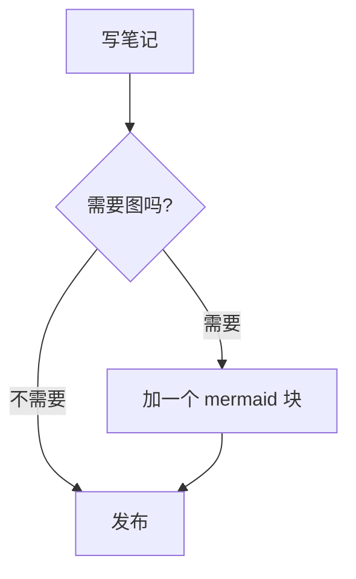
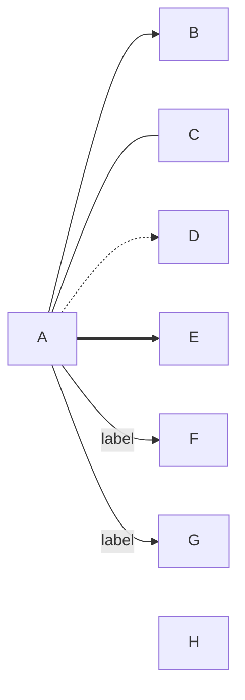
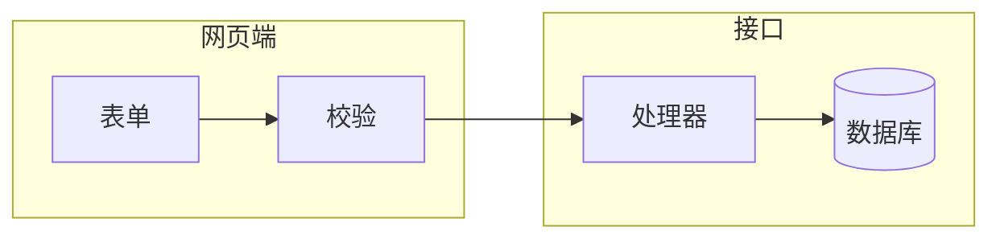
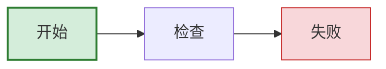

Mermaid 流程图就是一个语言名为 `mermaid` 的围栏代码块，第一行写 `flowchart` 加方向，`TD` 是从上到下，`LR` 是从左到右，后面每行像 `A[写笔记] --> B{完成了吗?}` 这样描述节点和连线，方括号是方框，花括号是菱形，`-->|是|` 给箭头加标签，`subgraph ... end` 把节点分组。出错多半集中在三处，小写的 `end`，标签里需要加引号的特殊字符，以及紧跟在连线后面、以 `o` 或 `x` 开头的节点名。这篇只讲流程图，其他图类型在 [Markdown 里画 Mermaid 图](/zh/blog/mermaid-diagrams-in-markdown/) 里。

## 最小的流程图

````markdown

````

第一行是图的类型和方向，`flowchart` 和 `graph` 都能用。后面每一行声明节点和连线，节点第一次出现时就创建了，之后的行直接用它的 id。`A[写笔记]` 里 `A` 是连线时用的 id，方括号里的文字才是画出来的内容，只写 `A` 的话 id 同时就是标签。

## 方向

| 关键字 | 流向 |
| --- | --- |
| `TD` 或 `TB` | 从上到下 |
| `BT` | 从下到上 |
| `LR` | 从左到右 |
| `RL` | 从右到左 |

`TD` 和 `TB` 是一回事。按内容的形状选，一条很长的线性流程在宽窗口里用 `LR` 更好读，分支很多的决策树一般用 `TD` 更合适。妙言会把图缩小到刚好放进预览的宽度，所以窄窗口里很长的 `LR` 图文字会变小，遇到这种情况换成 `TD`。

## 节点形状

经典写法靠文字外面的括号决定形状：

| 写法 | 形状 |
| --- | --- |
| `A[text]` | 矩形 |
| `A(text)` | 圆角矩形 |
| `A([text])` | 体育场形（药丸） |
| `A[[text]]` | 子程序框 |
| `A[(text)]` | 圆柱，常用来表示数据库 |
| `A((text))` | 圆形 |
| `A(((text)))` | 双圆 |
| `A{text}` | 菱形，用来表示判断 |
| `A{{text}}` | 六边形 |
| `A>text]` | 不对称旗帜形 |
| `A[/text/]` 和 `A[\text\]` | 平行四边形 |
| `A[/text\]` 和 `A[\text/]` | 梯形 |

Mermaid 11.3.0 加了第二种写法，形状多得多，写成 `A@{ shape: cyl, label: "订单库" }`，名字有 `cyl`、`diam`、`hex`、`doc`、`stadium`、`circle` 等，每个还有 `database`、`decision` 这样的别名。它比较啰嗦，只在括号表达不了的形状上才值得用，比如文档或层叠矩形。妙言 V4.9.0 打包的是 Mermaid 11.14.0，两种写法都能用，完整的形状列表在 [Mermaid 流程图文档](https://mermaid.js.org/syntax/flowchart.html) 里。

## 连线、标签和连写

````markdown

````

| 写法 | 含义 |
| --- | --- |
| `A --> B` | 箭头 |
| `A --- B` | 没有箭头的线 |
| `A -.-> B` | 虚线箭头 |
| `A ==> B` | 粗箭头 |
| `A ~~~ B` | 不可见的连线，只影响布局 |
| `A --o B`、`A --x B` | 末端是圆圈或叉 |
| `A <--> B` | 两端都有箭头 |

标签文字放在两根竖线之间，`A -->|text| B`，或者写在线中间，`A -- text --> B`，虚线和粗线也是这两种形式，`A -. text .-> B` 与 `A == text ==> B`。多加几个横线可以把连线拉长，`B ---->|No| E` 会让连到 `E` 的线比普通的 `-->` 多跨两层，图里线交叉时可以这样调。

一行里可以连写，`A --> B --> C`，也可以用 `&` 一对多或多对一，`A & B --> C & D` 等于四条连线。以 `%%` 开头的行是注释，会被忽略。

## 子图

````markdown

````

`subgraph id [标题]` 开一个分组，`end` 收尾，有了 id 就能把整组当作一个节点来连，比如 `web --> api`。子图里的 `direction` 可以单独设方向，但按 Mermaid 文档的说法，只要子图里有节点连到了子图外面，这个子图就会忽略自己的方向、沿用外层的，上面的例子里 `B --> C` 正好跨了边界，所以 `direction TB` 那行可能不起作用，依赖它之前先试一下。

## 样式少加一点

````markdown

````

`classDef 名字 属性:值,...` 定义样式，节点后面的 `:::名字` 套用样式，`class A,B 名字` 可以一次给几个节点套用。`style A fill:#f9f` 只改一个节点，`linkStyle 0 stroke:#f00` 按连线在文中出现的顺序从 0 开始改一条线。两三个样式类就够了，需要十种颜色的图通常该拆开而不是上色。

妙言的预览自带一套配色，浅色模式用 neutral 主题，深色模式用 dark 主题，连线画成平滑的曲线，你用 `classDef` 或 `style` 写的颜色会盖在这套主题上面，所以选浅色和深色背景下都看得清的颜色，或者干脆不写。

## 它是怎么工作的

[Markdown 里画 Mermaid 图](/zh/blog/mermaid-diagrams-in-markdown/) 里讲过，预览会把每个 `mermaid` 围栏交给随应用打包的 Mermaid 库，再用它返回的 SVG 替换掉代码，整个过程不走网络。SVG 按图的文字加上浅色或深色外观一起缓存，切换外观时会用原始文字重新画一遍。

GitHub 在它那边做的是同一件事，README、issue、拉取请求和 wiki 里的 `mermaid` 围栏都会渲染成图。GitHub 跑的是它自己的 Mermaid 版本，可能和你编辑器里的不一样，在 GitHub 的 `mermaid` 围栏里单独写一个 `info` 就能看到它用的版本，写法尽量不要超过两边中较旧的那个。

## 出错了怎么查

- **小写的 `end`。** 文字是 `end` 的节点会让图提前结束，写成 `End` 或 `END`，或者加引号。
- **标签里的特殊字符。** `[...]` 里的圆括号、方括号和引号这类字符可能被当成语法，把文字包进双引号，`A["费用 (USD)"]`，双引号本身写成 `#quot;`，`#9829;` 则按十进制编码给出一个字符。
- **以 `o` 或 `x` 开头的节点名。** 不加空格写成 `dev---ops`，可能被读成带圆圈末端的连线而不是连到 `ops`，按 Mermaid 文档的建议加个空格，`dev--- ops`，或者把 id 首字母大写，`dev---Ops`。
- **代码块还是代码。** 妙言里 Mermaid 解析失败时，原始文字会留在原处，也不会画出错误信息，所以没渲染出来就说明有语法错误，可以从最后一行开始往上删，删到能渲染为止，最后删掉的那行就是问题所在，贴进 Mermaid 在线编辑器能看到更准确的报错。
- **布局乱成一团。** 调整声明顺序、换方向、加一条不可见连线 `~~~`，或者拆成两张图。

在妙言里检查的话，输入 `/mermaid` 再按 `Tab` 会插入一个三节点的模板，按 `⌘3` 切到预览或按 `⌘\` 打开分栏，再把你的文字贴上去。同样的围栏也能用在[幻灯片](/zh/blog/markdown-to-slides/)和导出里，围栏的通用写法在 [Markdown 速查表](/zh/blog/markdown-cheat-sheet/)里。

## 限制

节点超过三十个左右的流程图，在哪个渲染器里都不好读。比 Mermaid 11.14.0 更新的功能，比如 11.17.0 加入的可折叠子图，在妙言 V4.9.0 里用不了，具体是被忽略还是报错要看写法。如果流程只是一个大纲结构，[Markmap](/zh/blog/markmap-mind-maps/) 可能更合适。

## 常见问题

### 一个节点能同时连到好几个节点吗？

可以，用 `&`。`A --> B & C` 从 `A` 画出两条线，`A & B --> C & D` 画出四条。

### 为什么图在 GitHub 上能渲染，在我的编辑器里不行，或者反过来？

两边跑的 Mermaid 版本不同。在 GitHub 的 `mermaid` 围栏里单独写 `info` 看它的版本，再和编辑器打包的版本比一下，妙言 V4.9.0 打包的是 11.14.0。

### `flowchart` 和 `graph` 有什么区别？

画出来是同一张图，妙言打包的 Mermaid 11.14.0 里两个关键字走的是同一个流程图解析器，`@{ shape: ... }` 跟在哪个后面都能用，Mermaid 文档的示例全部用 `flowchart`，照着抄用它更稳。
