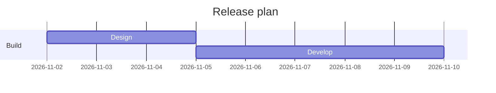
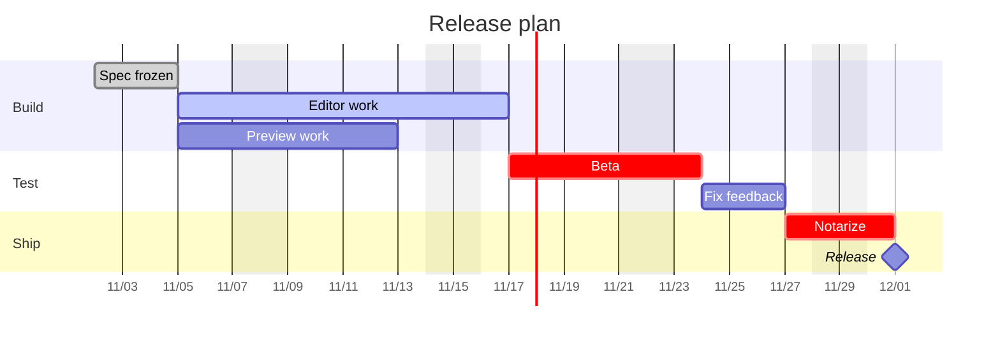

A Mermaid Gantt chart is a fenced code block tagged `mermaid` that starts with the word `gantt`. Set `dateFormat` to match the dates you type in task lines, add a `section` per phase, and write each task as `Title :tags, id, start, length`. `dateFormat` describes the input and `axisFormat` describes what the time axis prints, and mixing the two up is the most common reason a chart fails to render or comes out shifted. This post covers the full syntax of the Gantt type; for the other diagram types see [Mermaid diagrams in Markdown](/blog/mermaid-diagrams-in-markdown/).

## A minimal chart

````markdown

````

`title` is optional and sits above the chart. `dateFormat` tells the parser how to read dates, with `YYYY-MM-DD` as the default. Each `section` is a labelled group of rows and needs a name. Everything else is a task line: a title, a colon, then metadata. Comments go on their own line and start with `%%`.

## Task syntax

Put together, a task line reads `Title :[tags,] [id,] [start,] end-or-length`. Tags come first and are optional, and what follows is read by how many items there are:

- One item is the end date, or a duration added to the previous task's end.
- Two items are the start and then the end or duration. The start is a date or `after <id>`.
- Three items are an id, a start, and an end or duration. Other tasks refer to the id.

```markdown
Design   :done,   des, 2026-11-02, 3d
Develop  :active, dev, after des, 5d
Review   :crit,   rev, after dev, 2d
Launch   :milestone, 2026-11-14, 0d
```

The tags are `done`, `active`, `crit` and `milestone`. `done` marks a finished task, `active` the current one, `crit` a critical one, and `milestone` makes a single point in time instead of a bar. Mermaid 11.14.0 also lists `vert` as a tag, a vertical marker across the chart that takes no row, though the documentation page does not say when it arrived.

Tasks are sequential by default. A task with no start begins when the previous one ends, so you only write dates where the plan needs an anchor.

### Durations and after

A duration is a number and a unit: `ms`, `s`, `m`, `h`, `d`, `w`, `M` or `y`, and decimals such as `1.5d` parse, though Mermaid 11.14.0 rounds day and week durations to whole days, so `1.5d` draws as two days and half a day is better written `12h`. Note that `m` is minutes and capital `M` is months. An invalid duration is ignored and the task gets zero length, which is why a bar can vanish without any error.

`after <id>` starts a task when another one ends, and you can list several ids, as in `after edit prev`. The task then starts at the latest of their end dates, which is what you want for "testing begins when both are done". `until <id>` ends a task when another task or milestone starts; the documentation marks it as available since Mermaid 10.9.0.

## dateFormat and axisFormat

These two lines do different jobs.

`dateFormat` is the input format. It uses Day.js tokens such as `YYYY`, `MM`, `DD`, `HH`, `mm`, `X` for Unix seconds and `x` for milliseconds. Write it to match your task lines exactly, so `dateFormat DD/MM/YYYY` goes with `Design :a1, 02/11/2026, 3d`.

`axisFormat` is the output format. It uses d3 time tokens, with a percent sign in front: `%Y-%m-%d`, `%m/%d`, `%b %d`, `%H:%M`. Its default is `%Y-%m-%d`, the full date. A long chart with the default format prints crowded full dates, and `axisFormat %m/%d` is usually enough:

```markdown
dateFormat  YYYY-MM-DD
axisFormat  %b %d
```

The token families differ: `YYYY` belongs to `dateFormat` and `%Y` to `axisFormat`.

### Tick spacing

`tickInterval` sets how far apart the axis labels sit. The pattern is a positive integer and a unit, from `millisecond` through `second`, `minute`, `hour`, `day`, `week` and `month`, for example `1week`. The default is automatic spacing, and the option has existed since Mermaid 10.3.0, so the version in MiaoYan accepts it. Week ticks start on Sunday unless you add `weekday monday`.

```markdown
axisFormat   %m/%d
tickInterval 1week
weekday      monday
```

## Excluding weekends and days off

`excludes weekends` makes the bars skip Saturday and Sunday. You can also exclude a day name such as `sunday`, or specific dates in `YYYY-MM-DD`. Several values go on one line, separated by commas or spaces, as in `excludes weekends, 2026-12-25`, because in Mermaid 11.14.0 a second `excludes` line replaces the first. `weekdays` is not a valid value.

The effect on tasks has two sides. A day that falls inside a task stretches the bar to the right, so a 5d task that crosses a weekend ends two days later than it would otherwise. A day that falls between two sequential tasks is skipped, so the second one starts on the next working day.

If your week is not Saturday and Sunday, `weekend friday` or `weekend saturday` changes which two days count as the weekend. The documentation lists that for Mermaid 11.0.0 and later.

## Marking today

A Gantt chart can show a vertical line at the current date, and `todayMarker` styles it with CSS-like values:

```markdown
todayMarker stroke-width:3px,stroke:#d33,opacity:0.6
```

`todayMarker off` hides the line, which is useful in a plan that is not about the current week.

## A full release plan

````markdown

````

`Editor work` and `Preview work` both start when `spec` ends, so they run in parallel. `Beta` waits for the later of the two. `excludes weekends` pushes every bar across Saturdays and Sundays, and the 8d editor task therefore lasts longer than eight calendar days. The milestone takes zero days and appears as a single marker on the day the notarize step ends. Change one duration and everything after it moves, which is the reason to use `after <id>` rather than typing every date.

## How it actually works

A fenced block with the language `mermaid` is plain text to the Markdown parser. Your preview finds it after the page loads and hands the text to the Mermaid library, which parses the Gantt grammar, resolves every `after` reference into dates, applies the exclusions and draws an SVG. 

MiaoYan V4.9.0 bundles Mermaid 11.14.0 and runs it from files inside the app, so Gantt charts render without a network connection. The Gantt grammar in that bundled file includes `tickInterval`, `weekend`, `until`, `todayMarker` and the `vert` tag. Syntax added in a later Mermaid release is not, so test a new option with a small chart first.

## Common errors

- **The bars sit at the wrong dates, or the chart does not render.** `dateFormat` probably does not match the dates in the task lines. When a date does not fit `dateFormat`, Mermaid falls back to the browser's own date parsing, so `02/11/2026` under `dateFormat YYYY-MM-DD` lands on February 11, and a date neither can read is an error. Compare character by character, including separators and zero padding.
- **The diagram stays as code.** A syntax error stops rendering, and MiaoYan keeps the original fenced source in place when that happens. Look for a missing colon between a task title and its metadata, or a date that matches no format.
- **A task appears at the wrong place.** Check the id in `after`: an id that matches no task does not raise an error, it starts the task on today's date. Keep ids short, single words, and spell them the same in both places.
- **A bar is missing.** Look at the duration unit. `5m` is five minutes, not five months.
- **Dates shifted after excluding weekends.** That is expected: excluded days stretch bars and skip gaps, as described above.
- **Axis labels crowd together.** Set `axisFormat %m/%d` and `tickInterval 1week`.
- **An option has no effect.** It may have arrived after the bundled version. Check the version note in the Mermaid documentation.

To confirm the chart works, paste the full plan above into a note, switch to preview with `⌘3` or open split view with `⌘\`, and check that Preview work and Editor work start on the same date.

If the diagram is a plan that people will present, [Markdown to slides](/blog/markdown-to-slides/) covers turning a note into a deck, and [Markdown to PDF on Mac](/blog/markdown-to-pdf-mac/) covers exporting it. MiaoYan is on the [App Store](https://apps.apple.com/app/id6759252269), and its source is at [github.com/tw93/MiaoYan](https://github.com/tw93/MiaoYan).

## FAQ

### What is the difference between dateFormat and axisFormat?

`dateFormat` is how you write dates in task lines. `axisFormat` is how the timeline prints them.

### How do I make a task start after another one?

Give the first task an id and write `after <id>` as the second task's start. Several ids work, and the task starts after the last of them ends.

### How do I skip weekends in a Mermaid Gantt chart?

Add `excludes weekends` under `dateFormat`. Bars stretch across the days they skip.

### Can a Gantt chart show hours?

Yes. Use a `dateFormat` with time tokens such as `YYYY-MM-DD HH:mm`, durations in `h` or `m`, and an `axisFormat` such as `%H:%M`.
