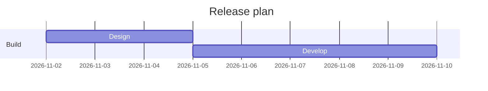
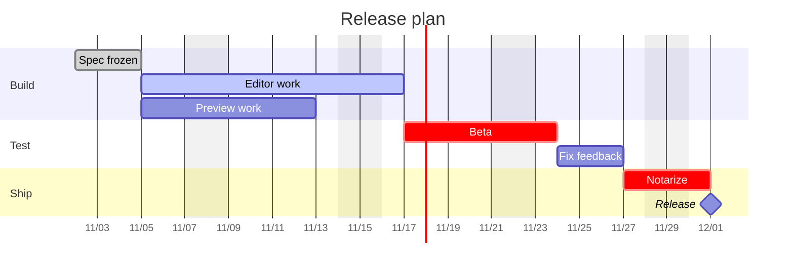

Mermaid 甘特图就是一个语言名为 `mermaid`、第一行写 `gantt` 的围栏代码块，用 `dateFormat` 声明任务行里日期的写法，每个阶段一个 `section`，每个任务写成 `标题 :标签, id, 开始, 时长`。`dateFormat` 管输入，`axisFormat` 管时间轴上显示什么，两个搞混是图画不出来或者日期错位最常见的原因。这篇只讲甘特图本身的语法，其他图类型见 [Markdown 里画 Mermaid 图](/zh/blog/mermaid-diagrams-in-markdown/)。

## 最小的一张图

````markdown

````

`title` 可有可无，显示在图的上方，`dateFormat` 告诉解析器怎么读日期，默认值是 `YYYY-MM-DD`，每个 `section` 是一组带名字的行，名字不能省，其余都是任务行，也就是标题、冒号，再接元数据。注释单独占一行，以 `%%` 开头。

## 任务行语法

合起来一行任务写成 `标题 :[标签,] [id,] [开始,] 结束或时长`，标签在最前面，可以不写，后面的内容按个数来理解：

- 一项是结束日期，或者加在上一个任务结束时间上的时长。
- 两项是开始，然后是结束或时长，开始可以是日期，也可以是 `after <id>`。
- 三项是 id、开始、结束或时长，其他任务通过 id 引用它。

```markdown
Design   :done,   des, 2026-11-02, 3d
Develop  :active, dev, after des, 5d
Review   :crit,   rev, after dev, 2d
Launch   :milestone, 2026-11-14, 0d
```

标签有 `done`、`crit`、`active` 和 `milestone`，`done` 表示已完成，`active` 表示正在做，`crit` 表示关键任务，`milestone` 不画条，只画时间上的一个点。Mermaid 11.14.0 的语法里还有一个 `vert` 标签，是横穿整张图、不占行的竖线，不过文档页没有写它是哪个版本加的。

任务默认按顺序排，没有写开始时间的任务从上一个结束的地方接着开始，所以只需要在计划真正有锚点的地方写日期。

### 时长和 after

时长是数字加单位，可以是 `ms`、`s`、`m`、`h`、`d`、`w`、`M` 或 `y`，也可以写 `1.5d` 这样的小数，不过 Mermaid 11.14.0 会把天和周的时长取整到整天，`1.5d` 画出来是两天，半天更适合写成 `12h`，注意小写 `m` 是分钟，大写 `M` 才是月。写错的时长会被忽略，任务长度变成零，所以条会消失而不报错。

`after <id>` 让任务在另一个任务结束后开始，可以写多个 id，比如 `after edit prev`，这时取它们结束时间里最晚的一个，适合「两边都做完才开始测试」。`until <id>` 让任务一直持续到另一个任务或里程碑开始，文档标注它从 Mermaid 10.9.0 起可用。

## dateFormat 和 axisFormat

这两行管的是两件事。

`dateFormat` 是输入格式，用的是 Day.js 的记号，比如 `YYYY`、`MM`、`DD`、`HH`、`mm`，`X` 是 Unix 秒，`x` 是毫秒，要和任务行里的写法完全一致，所以 `dateFormat DD/MM/YYYY` 要配 `Design :a1, 02/11/2026, 3d`。

`axisFormat` 是输出格式，用的是 d3 的时间记号，前面带百分号，比如 `%Y-%m-%d`、`%m/%d`、`%b %d`、`%H:%M`，默认是 `%Y-%m-%d`，也就是完整日期。图一长，默认格式会挤满完整日期，通常写 `axisFormat %m/%d` 就够了：

```markdown
dateFormat  YYYY-MM-DD
axisFormat  %b %d
```

两套记号不一样，`YYYY` 属于 `dateFormat`，`%Y` 属于 `axisFormat`。

### 刻度间隔

`tickInterval` 决定时间轴上标签之间隔多远，写法是一个正整数加单位，单位从 `millisecond`、`second`、`minute`、`hour`、`day`、`week` 到 `month`，比如 `1week`，默认是自动，这个选项从 Mermaid 10.3.0 起就有，妙言自带的版本认得它。按周的刻度默认从周日开始，要从周一开始就加 `weekday monday`。

```markdown
axisFormat   %m/%d
tickInterval 1week
weekday      monday
```

## 排除周末和休息日

`excludes weekends` 让条跳过周六和周日，也可以排除某个星期几，比如 `sunday`，或者 `YYYY-MM-DD` 形式的具体日期，多个值写在同一行，用逗号或空格隔开，比如 `excludes weekends, 2026-12-25`，不要分成两行写，Mermaid 11.14.0 里第二行 `excludes` 会覆盖第一行。另外 `weekdays` 不是合法值。

对任务的影响有两面，落在任务中间的休息日会把条往右拉长，一个 5d 的任务跨过周末就会晚两天结束，落在两个顺序任务之间的休息日会被跳过，后一个任务从下一个工作日开始。

如果你的周末不是周六周日，写 `weekend friday` 或 `weekend saturday` 就能改哪两天算周末，文档标注这个功能从 Mermaid 11.0.0 起可用。

## 标出今天

甘特图可以画一条表示当前日期的竖线，`todayMarker` 用类似 CSS 的值来改它的样子：

```markdown
todayMarker stroke-width:3px,stroke:#d33,opacity:0.6
```

`todayMarker off` 会把这条线藏起来，计划和当前这一周无关的时候很有用。

## 一份完整的发布计划

````markdown

````

`Editor work` 和 `Preview work` 都在 `spec` 结束后开始，所以并行，`Beta` 等两者里更晚结束的那个，`excludes weekends` 让每个条都绕过周六周日，8d 的编辑任务因此要占用超过八个自然日，里程碑长度为零，只在 Notarize 结束那天画一个点。改一个时长，后面的全部跟着动，这就是用 `after <id>` 而不是逐个手写日期的原因。

## 它实际是怎么工作的

带 `mermaid` 语言名的围栏块对 Markdown 解析器来说只是文本，预览在页面加载后找到它，把文本交给 Mermaid 库，库解析甘特图语法，把每个 `after` 引用换算成日期，应用排除规则，再画成 SVG。

妙言 V4.9.0 自带 Mermaid 11.14.0，从应用内的文件运行，所以甘特图离线也能渲染。打包文件里的甘特图语法包含 `tickInterval`、`weekend`、`until`、`todayMarker` 和 `vert` 标签。更新的 Mermaid 版本才加的写法这里没有，用新选项之前先拿一张小图试。

## 常见错误

- **条落在错误的日期，或者图画不出来。** 多半是 `dateFormat` 和任务行里的日期对不上，日期不符合 `dateFormat` 时 Mermaid 会退回浏览器自己的日期解析，`dateFormat YYYY-MM-DD` 下写 `02/11/2026` 会落到 2 月 11 日，两边都读不懂的日期直接报错，逐个字符对照，包括分隔符和补零。
- **图一直显示成代码。** 语法错误会让渲染停下来，妙言在这时会把原始围栏源码留在原位，检查任务标题和元数据之间是不是少了冒号，或者有没有哪个日期怎么都读不出来。
- **任务出现在不对的位置。** 检查 `after` 里的 id，找不到对应任务的 id 不会报错，而是让任务从今天开始，id 写成简短的单个词，两处拼写保持一致。
- **条不见了。** 看时长单位，`5m` 是五分钟，不是五个月。
- **排除周末后日期变了。** 这是预期行为，休息日会拉长条并跳过间隙，见上文。
- **时间轴标签挤在一起。** 写 `axisFormat %m/%d` 和 `tickInterval 1week`。
- **某个选项没有效果。** 它可能是在自带版本之后才加的，对照 Mermaid 文档里的版本说明。

确认图能用，可以把上面整份计划贴进一篇笔记，按 `⌘3` 切到预览或按 `⌘\` 打开分栏，看 Preview work 和 Editor work 是否从同一天开始。

计划如果要拿去演示，[Markdown 转幻灯片](/zh/blog/markdown-to-slides/)讲怎么把笔记变成演示文稿，[在 Mac 上把 Markdown 转成 PDF](/zh/blog/markdown-to-pdf-mac/)讲导出。妙言在 [App Store](https://apps.apple.com/app/id6759252269) 上，源码在 [github.com/tw93/MiaoYan](https://github.com/tw93/MiaoYan)。

## 常见问题

### dateFormat 和 axisFormat 有什么区别？

`dateFormat` 是任务行里日期的写法，`axisFormat` 是时间轴显示日期的写法。

### 怎么让一个任务在另一个任务之后开始？

给前一个任务一个 id，后一个任务的开始写 `after <id>`，可以写多个 id，任务在最后结束的那个之后开始。

### Mermaid 甘特图怎么跳过周末？

在 `dateFormat` 下面加 `excludes weekends`，条会跨过被跳过的日子往后拉长。

### 甘特图能显示小时吗？

可以，`dateFormat` 用带时间的记号比如 `YYYY-MM-DD HH:mm`，时长用 `h` 或 `m`，`axisFormat` 写成 `%H:%M` 之类。
