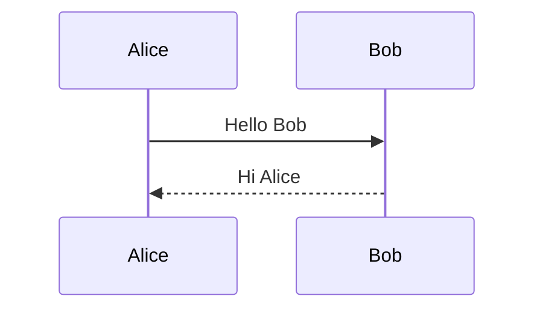
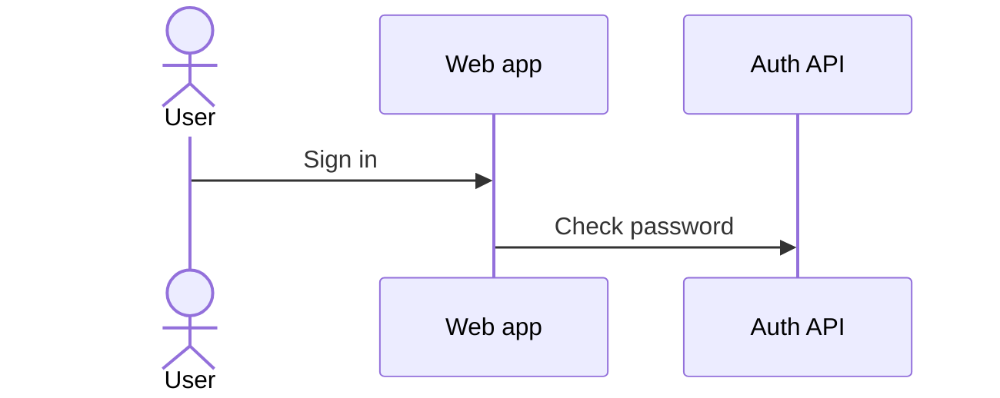
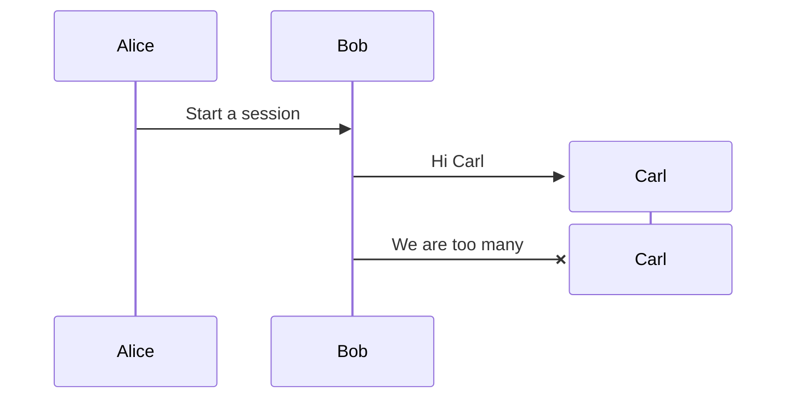
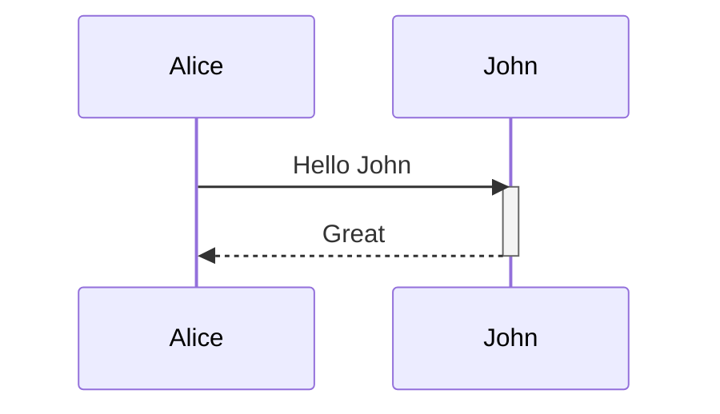
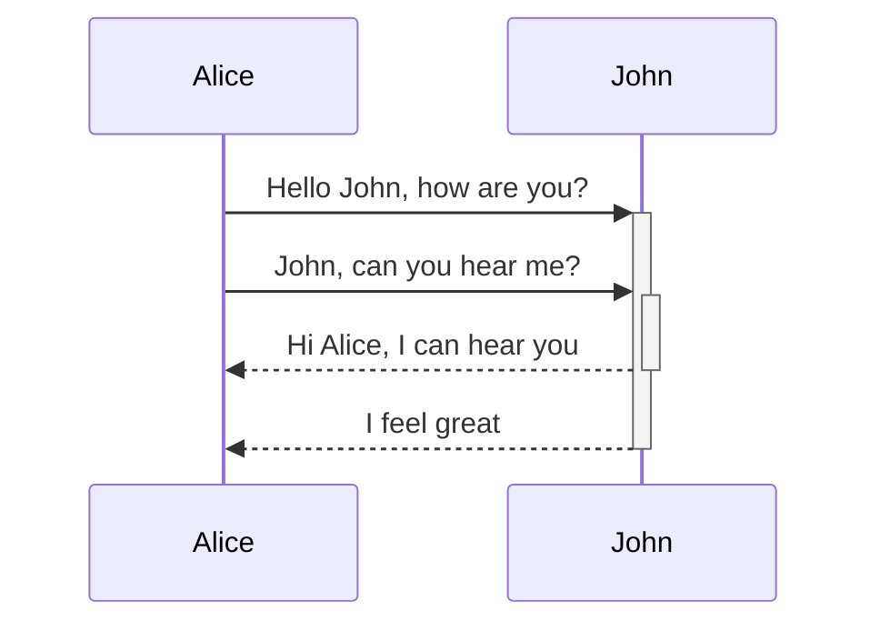
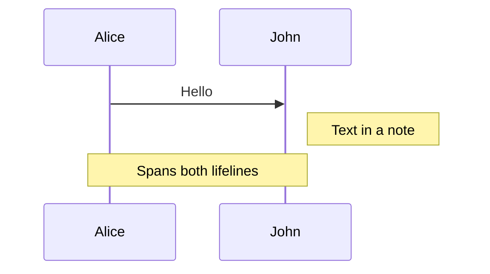
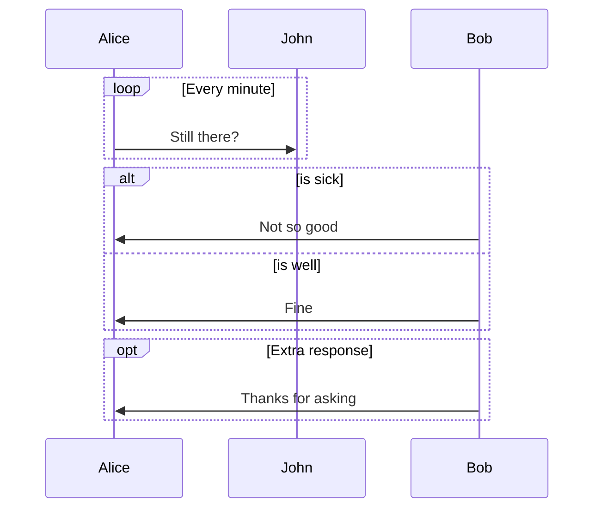
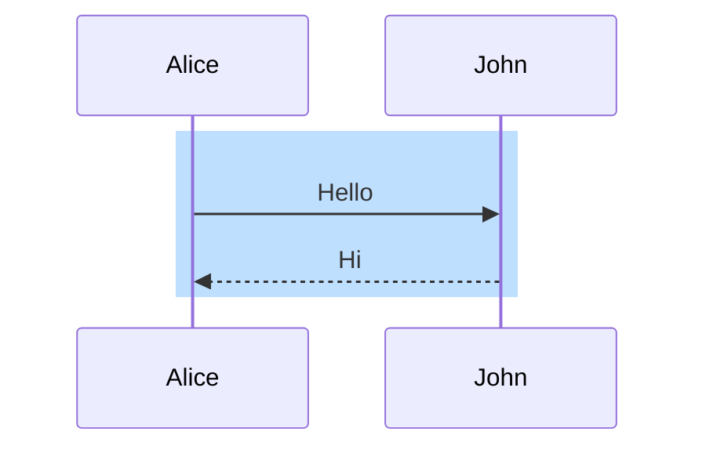
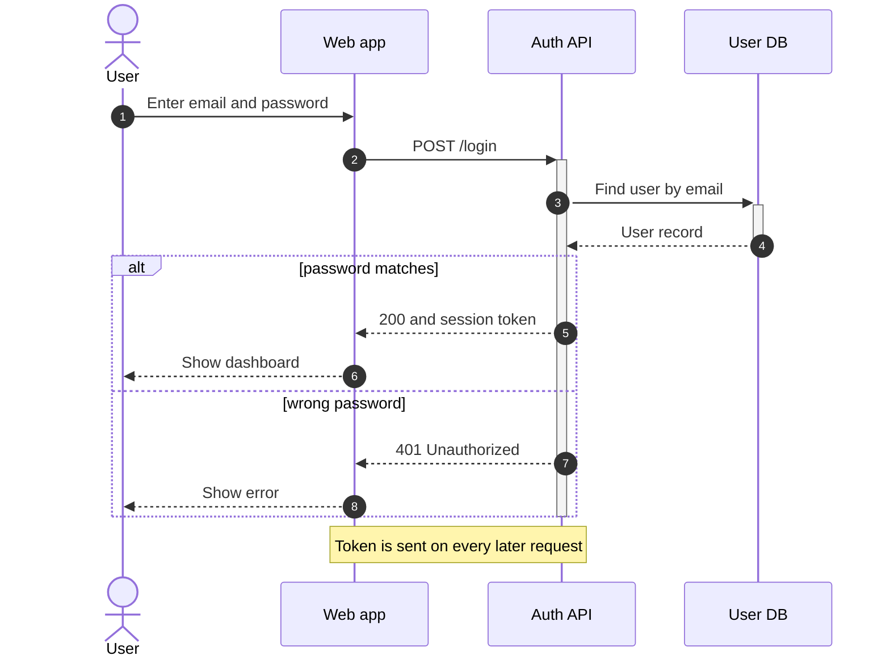

A Mermaid sequence diagram starts with the line `sequenceDiagram` inside a fenced block tagged `mermaid`, followed by one line per message in the form `Sender->>Receiver: text`. Participants appear in the order they are first mentioned, so for a small diagram you can skip declaring them. Declare them when you want readable labels, a fixed order or a stick figure. This post covers the syntax up to Mermaid 11.14.0, which is the version MiaoYan V4.9.0 bundles; the [overview of Mermaid in Markdown](/blog/mermaid-diagrams-in-markdown/) covers the other diagram types.

## The smallest diagram

````markdown

````

Each line draws one arrow between two lifelines, top to bottom in the order written. There is nothing else to set up.

## Participants, actors and aliases

````markdown

````

`participant` draws a box and `actor` draws a stick figure; both take part in messages the same way. The word after `as` is the label shown in the diagram, and the first word is the short id you type in messages. Declaring participants up front also fixes their left-to-right order, which otherwise follows first appearance. To put a line break in a name, use an alias containing `<br/>`, as in `participant A as Auth<br/>API`.

Mermaid also lets a participant be created and removed in the middle of the flow, from version 10.3.0:

````markdown

````

Only the receiver of a message can be created, and `destroy` ends the lifeline with a cross. To group several participants under a coloured band, wrap their declarations in `box Name ... end`, with an optional colour such as `rgb(191, 223, 255)` before the name. Hex colours do not work there, because `#` starts a comment.

## Message arrow types

| Syntax | What it draws |
| --- | --- |
| `->` and `-->` | solid and dotted line, no arrowhead |
| `->>` and `-->>` | solid and dotted line with arrowhead |
| `-x` and `--x` | solid and dotted line ending in a cross |
| `-)` and `--)` | solid and dotted open arrow, for async messages |
| `<<->>` and `<<-->>` | bidirectional, from Mermaid 11.0.0 |

The usual convention is a solid `->>` for a request and a dotted `-->>` for the reply. Use `-x` for a message that fails or is lost, and `-)` when the sender does not wait. Mermaid 11.12.3 added half arrowheads such as `-|\` and central-connection markers such as `Alice->>()John`; both are inside the bundled version, and both are rarely needed.

## Activation bars

An activation bar is the thin rectangle on a lifeline that shows a participant is busy. The explicit form is two lines:

````markdown

````

The shorthand puts `+` or `-` right after the arrow: `+` activates the receiver and `-` deactivates the sender, so a reply marked `-` closes the bar its request opened:

````markdown

````

Bars on the same participant stack, and each `-` closes one of them.

## Notes

````markdown

````

Positions are `right of`, `left of` and `over`, and `over` accepts two participants separated by a comma to stretch across both. A line break inside a note or a message is `<br/>`.

## Loop, alt, opt, par, critical and break

Each block opens with a keyword and a label, can hold messages and further blocks, and closes with `end`:

````markdown

````

- `loop` repeats what is inside.
- `alt` ... `else` ... `end` shows alternatives, and `else` can repeat.
- `opt` is an `alt` with only one branch, for something that may or may not happen.
- `par` ... `and` ... `end` shows messages that happen in parallel, and blocks can nest.
- `critical` ... `option` ... `end` marks an action that must succeed, with `option` lines for what happens on failure.
- `break` ... `end` shows the flow stopping when a condition is met.

## Autonumber and background highlighting

Put `autonumber` on its own line, before the messages, and every arrow gets a number. A start value and increment can follow it, but decimal values there arrived in Mermaid 11.15.0, which MiaoYan V4.9.0 does not have, so stay with the plain keyword.

`rect` paints a coloured background behind part of the diagram. It takes `rgb()` or `rgba()` and closes with `end`:

````markdown

````

A line that starts with `%%` is a comment and must sit on its own line.

## A full example: login flow

````markdown

````

The database bar opens and closes inside the API bar. The API bar is closed with `deactivate A` after the `alt` block rather than with a `-` inside it, because Mermaid counts activations line by line and does not treat the branches as alternatives, so a `-` in each branch would close the API bar twice and the second one would fail.

## How MiaoYan renders it

The preview turns the fenced block into HTML with a `language-mermaid` class. A script then passes the text to the bundled `mermaid.min.js`, which reports version 11.14.0 in the V4.9.0 source, and puts the SVG in place of the code. Nothing is fetched, so it works offline. Colours follow the light or dark appearance. To insert a starter, type `/mermaid` and press `Tab`; the template is a flowchart, so replace its body with `sequenceDiagram`.

## Common errors

- **The diagram stays as code.** When Mermaid throws, MiaoYan keeps the original source in the preview and shows no error message. Look for a typo in an arrow, a missing `end`, or syntax newer than 11.14.0.
- **The word `end` in text.** The Mermaid documentation warns that it can break the diagram. Write it as `(end)`, `[end]` or `{end}`.
- **A semicolon in a message.** It is treated as a line break. Write `#59;`. Other entity codes work the same way, as in `I #9829; you`.
- **Deactivating an inactive participant.** A `-` or `deactivate` on a participant with no open bar makes Mermaid stop with `Trying to inactivate an inactive participant`, so the diagram stays as code. Count your `+` and `-`.
- **Creating the sender.** `create participant Carl` must be followed by a message that sends to Carl, not from him.
- **A comment after a message.** `%%` only works as a whole line.
- **Newer syntax.** Anything marked 11.15.0 or later in the Mermaid documentation, such as decimal `autonumber` values, will not render in V4.9.0.

To check a diagram, switch to preview with `⌘3` or split mode with `⌘\`. Exports to PDF come from the same preview, covered in [Markdown to PDF on Mac](/blog/markdown-to-pdf-mac/), and diagrams also render in presentation mode, covered in [Markdown to slides](/blog/markdown-to-slides/).

## FAQ

### What is the difference between participant and actor?

Only the symbol: a box for `participant`, a stick figure for `actor`. Use `actor` for a person.

### How do I draw a reply?

Draw a dotted arrow, `-->>`, in the opposite direction. That is a convention, not a separate message type.

### Can I put a diagram inside a note without a network?

Yes. In MiaoYan, Mermaid is bundled and renders offline.
