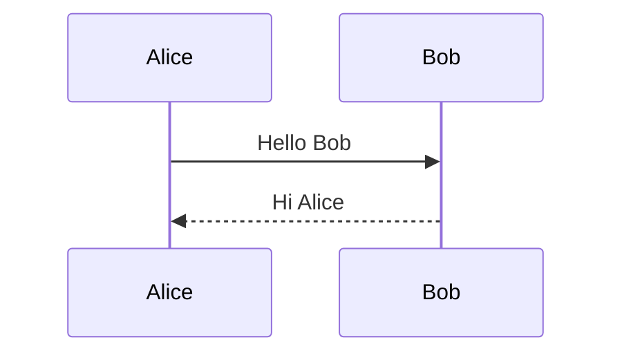
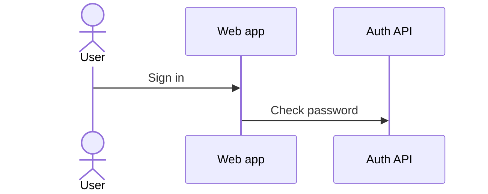
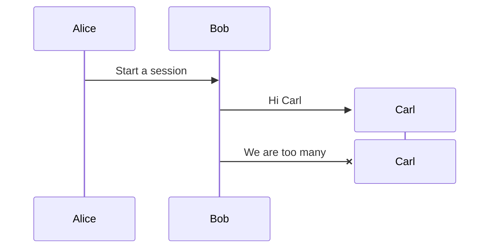
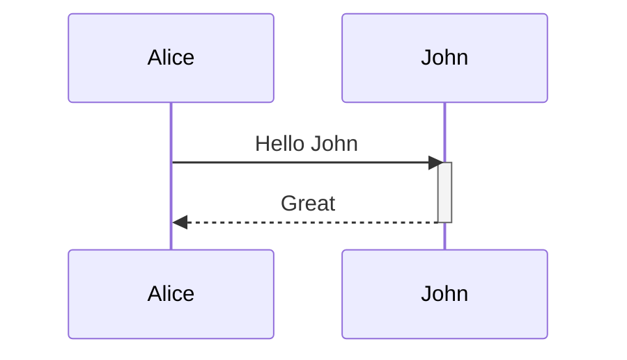
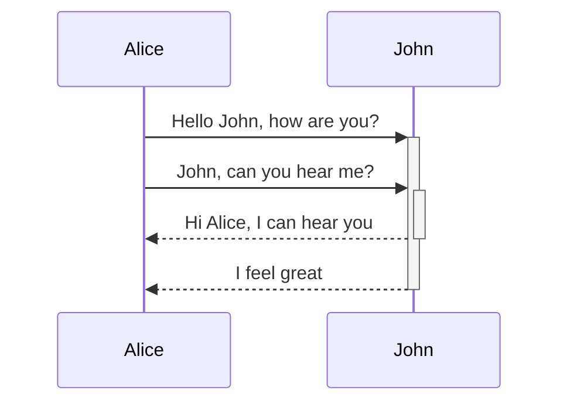
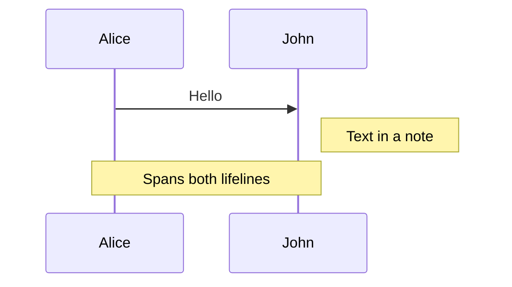
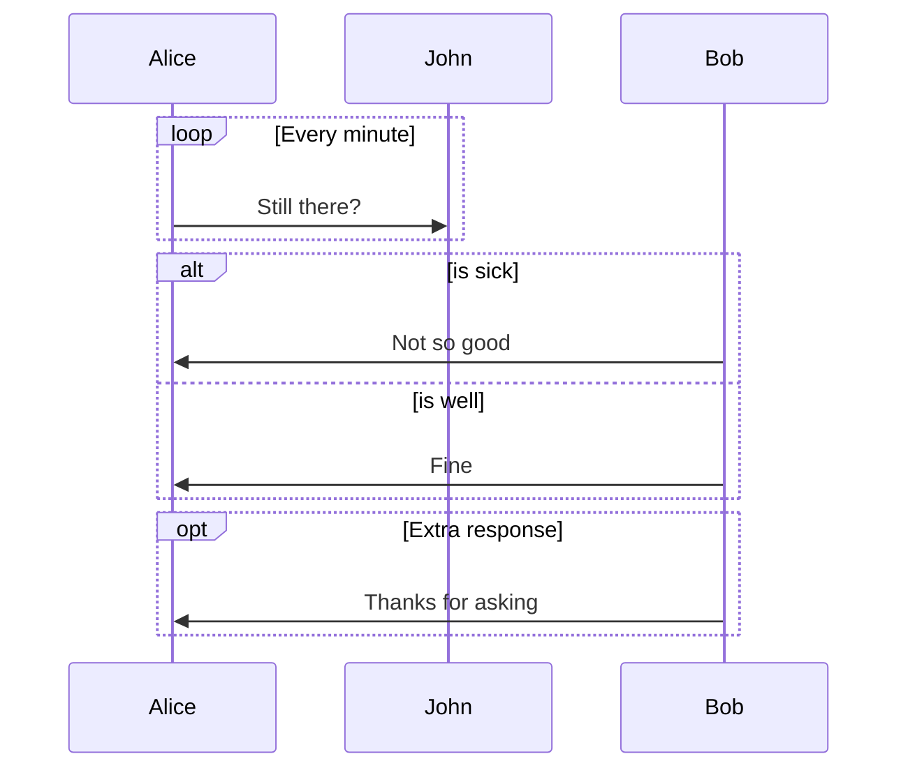
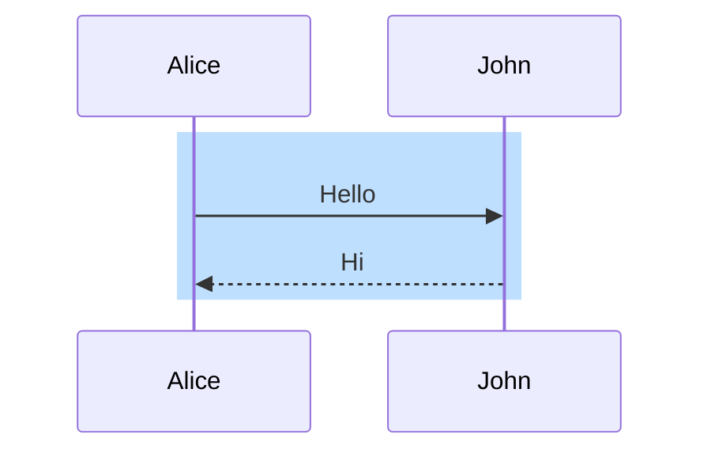
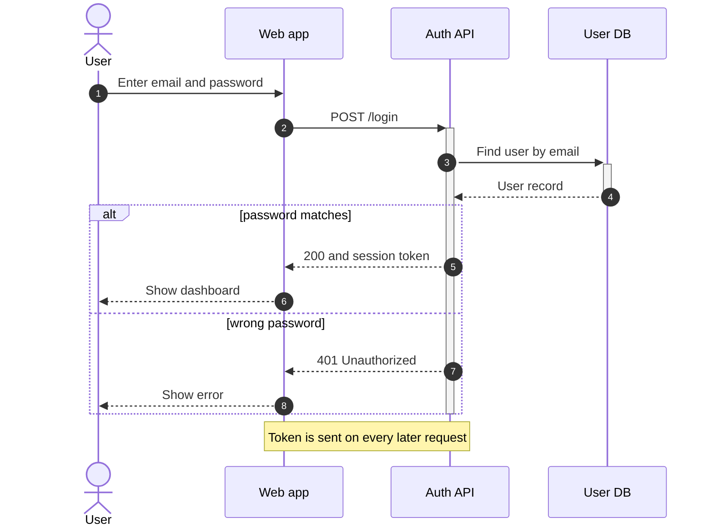

Mermaid 时序图的写法，是在语言名为 `mermaid` 的围栏代码块里先写一行 `sequenceDiagram`，后面每条消息一行，格式是 `发送方->>接收方: 文字`。参与者按第一次出现的顺序排列，图很小的时候可以不声明，想要好读的标签、固定的顺序或者火柴人，再单独声明。本文讲到 Mermaid 11.14.0 为止的语法，这是妙言 V4.9.0 随应用打包的版本，其他图类型放在 [Markdown 里画 Mermaid 图](/zh/blog/mermaid-diagrams-in-markdown/) 那篇里。

## 最小的时序图

````markdown

````

每一行在两条生命线之间画一根箭头，按写的顺序从上往下排，不需要别的设置。

## 参与者、角色和别名

````markdown

````

`participant` 画一个方框，`actor` 画一个火柴人，两者在消息里的用法完全一样。`as` 后面是图里显示的标签，前面那个词是消息里用的短 id。先声明参与者也就固定了从左到右的顺序，不声明的话顺序跟着第一次出现走。名字里要换行，就用带 `<br/>` 的别名，比如 `participant A as Auth<br/>API`。

从 10.3.0 起，参与者还可以在流程中间创建和销毁。

````markdown

````

只有消息的接收方可以被创建，`destroy` 会用一个叉结束这条生命线。想把几个参与者放进一条彩色底带，就把声明包在 `box 名称 ... end` 里，名称前可以加颜色，比如 `rgb(191, 223, 255)`，十六进制颜色在这里不能用，因为 `#` 会被当成注释。

## 消息箭头类型

| 写法 | 画出来的样子 |
| --- | --- |
| `->` 和 `-->` | 实线和虚线，没有箭头 |
| `->>` 和 `-->>` | 实线和虚线，带箭头 |
| `-x` 和 `--x` | 实线和虚线，末端是叉 |
| `-)` 和 `--)` | 实线和虚线的开口箭头，表示异步消息 |
| `<<->>` 和 `<<-->>` | 双向，Mermaid 11.0.0 起支持 |

常见的约定是请求用实线 `->>`，回复用虚线 `-->>`，消息失败或丢失用 `-x`，发送方不等回复就用 `-)`。Mermaid 11.12.3 又加了半箭头（比如 `-|\`）和中心连接标记（比如 `Alice->>()John`），都在打包的版本范围内，不过很少用到。

## 激活条

激活条是生命线上的一小段细长方块，表示这个参与者正在处理事情，显式写法是两行。

````markdown

````

简写是在箭头后面紧跟 `+` 或 `-`，`+` 激活接收方，`-` 结束发送方，所以带 `-` 的回复会关掉请求时打开的那条激活条。

````markdown

````

同一个参与者的激活条可以叠起来，每个 `-` 结束其中一条。

## 注释框

````markdown

````

位置有 `right of`、`left of` 和 `over`，`over` 后面可以用逗号写两个参与者，让注释框横跨两条生命线，注释和消息里要换行都用 `<br/>`。

## loop、alt、opt、par、critical 和 break

每种块都以关键字加标题开头，里面可以放消息和别的块，最后用 `end` 结束。

````markdown

````

- `loop` 重复里面的内容。
- `alt` ... `else` ... `end` 表示几种分支，`else` 可以写多次。
- `opt` 是只有一个分支的 `alt`，用在可能发生也可能不发生的事上。
- `par` ... `and` ... `end` 表示并行的消息，可以嵌套。
- `critical` ... `option` ... `end` 标记必须成功的动作，`option` 写失败时的处理。
- `break` ... `end` 表示满足条件后流程中止。

## 自动编号和背景高亮

在消息之前单独一行写 `autonumber`，每根箭头就有了编号。后面可以再跟起始值和增量，但小数值是 Mermaid 11.15.0 才有的，妙言 V4.9.0 还没有，所以只写 `autonumber` 就好。

`rect` 给图的一部分铺上彩色背景，接受 `rgb()` 或 `rgba()`，用 `end` 结束。

````markdown

````

以 `%%` 开头的行是注释，必须独占一行。

## 一个完整的登录流程

````markdown

````

数据库的激活条开在 API 的激活条里面，也先于它结束。API 的激活条是在 `alt` 块后面用 `deactivate A` 结束的，没有在分支里各写一个 `-`，因为 Mermaid 是一行一行数激活次数的，不会把两个分支当成二选一，两个分支各写一个 `-` 就会把 API 的激活条结束两次，第二次会报错。

## 妙言怎么渲染它

预览先把围栏块转成带 `language-mermaid` 类的 HTML，再由脚本把文字交给随应用打包的 `mermaid.min.js`，V4.9.0 源码里它报的版本是 11.14.0，生成的 SVG 会替换掉代码块，整个过程不联网，所以离线也能用，颜色跟着浅色或深色外观走。想插入起手模板，输入 `/mermaid` 再按 `Tab`，模板是一张流程图，把里面的内容换成 `sequenceDiagram` 就行。

## 常见错误

- **图一直显示成代码。** Mermaid 报错时，妙言会把原始源码留在预览里，不显示错误信息，可以检查箭头有没有拼错、`end` 有没有漏、用的是不是比 11.14.0 更新的语法。
- **文字里出现 `end`。** Mermaid 文档提醒它可能弄坏整张图，写成 `(end)`、`[end]` 或 `{end}`。
- **消息里的分号。** 它会被当成换行，写成 `#59;`，其他实体码用法一样，比如 `I #9829; you`。
- **结束一个没有激活的参与者。** 参与者没有打开的激活条时写 `-` 或 `deactivate`，Mermaid 会报 `Trying to inactivate an inactive participant` 并停止渲染，图就一直显示成代码，数一下 `+` 和 `-` 是不是成对。
- **创建发送方。** `create participant Carl` 后面必须紧跟一条发给 Carl 的消息，而不是 Carl 发出的。
- **消息后面加注释。** `%%` 只能整行使用。
- **更新的语法。** Mermaid 文档里标着 11.15.0 及以后的内容，比如 `autonumber` 的小数值，在 V4.9.0 里渲染不出来。

检查时按 `⌘3` 切到预览，或者按 `⌘\` 进分栏。导出 PDF 用的是同一份预览，见 [Mac 上 Markdown 转 PDF](/zh/blog/markdown-to-pdf-mac/)，演示模式里图也会渲染，见 [Markdown 转幻灯片](/zh/blog/markdown-to-slides/)。

## 常见问题

### participant 和 actor 有什么区别？

只有图形，`participant` 是方框，`actor` 是火柴人，代表人的时候用 `actor`。

### 回复怎么画？

反方向画一根虚线箭头 `-->>`，这是一种约定，不是单独的消息类型。

### 离线能在笔记里画时序图吗？

可以，妙言里的 Mermaid 随应用打包，离线也能渲染。
