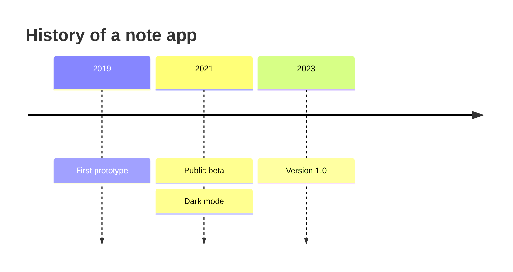
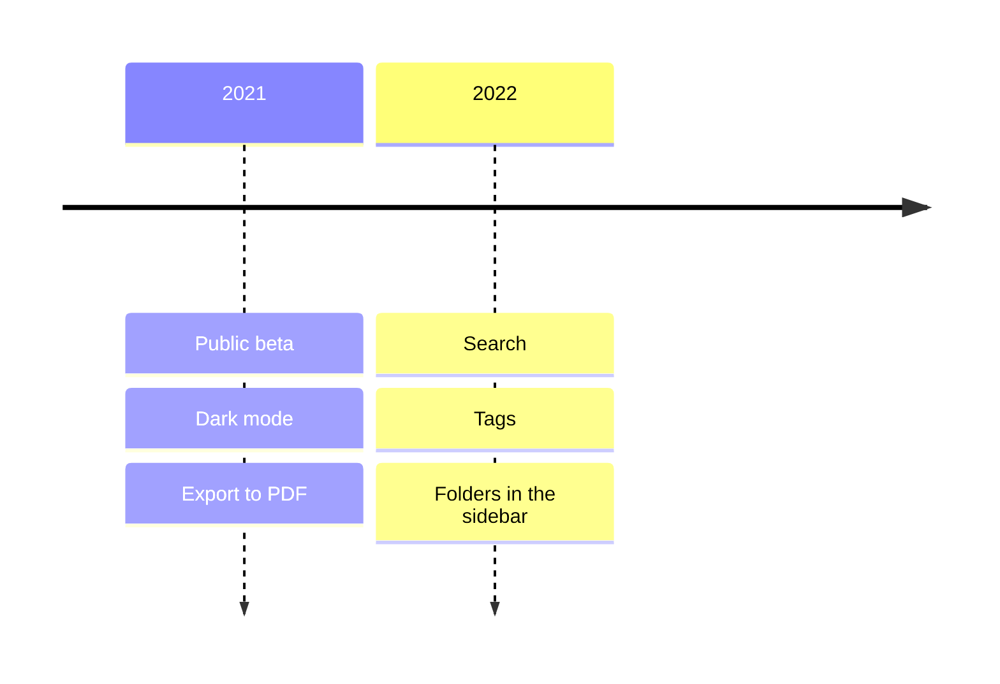
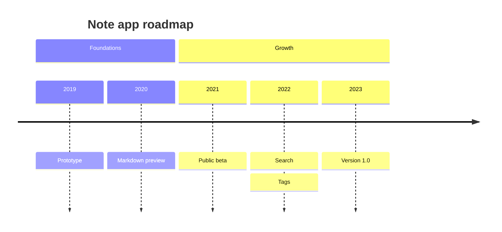
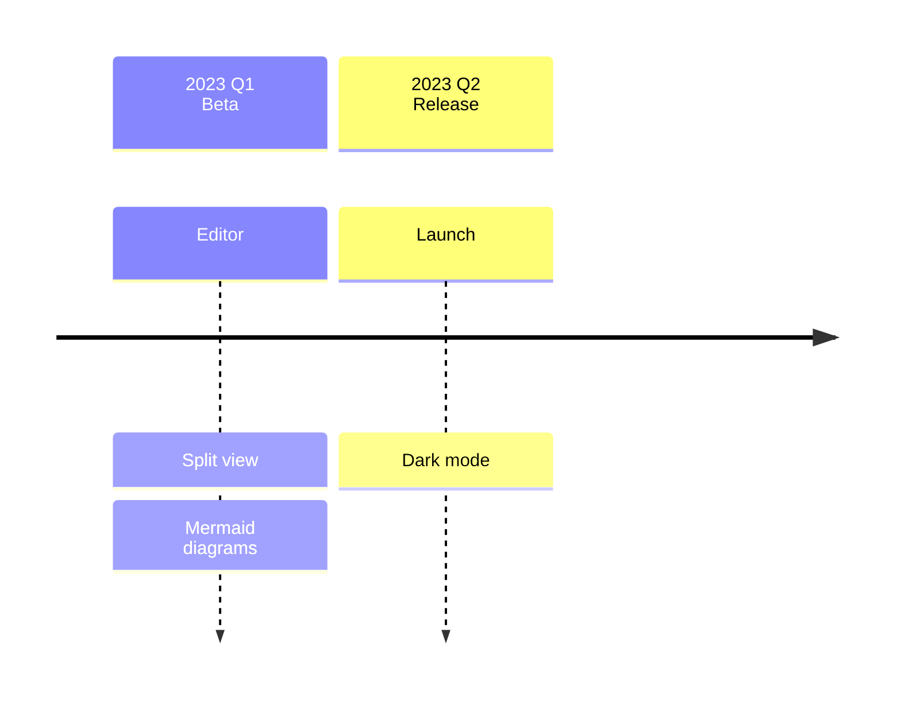
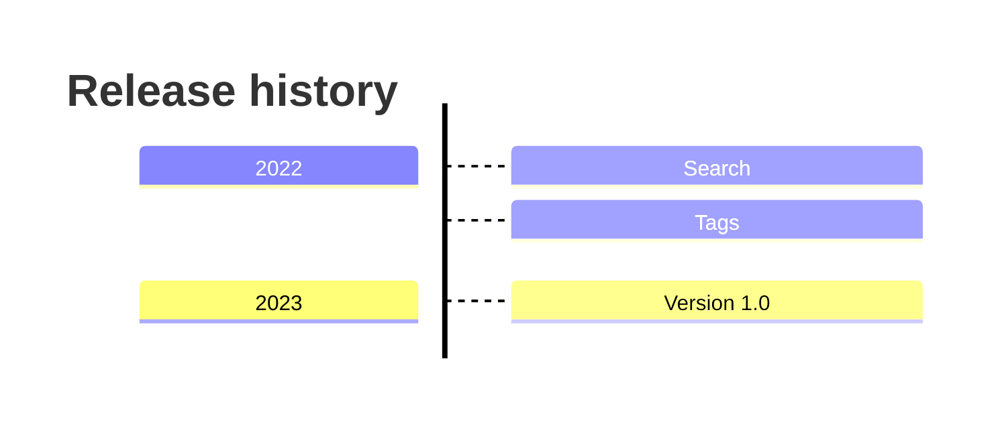
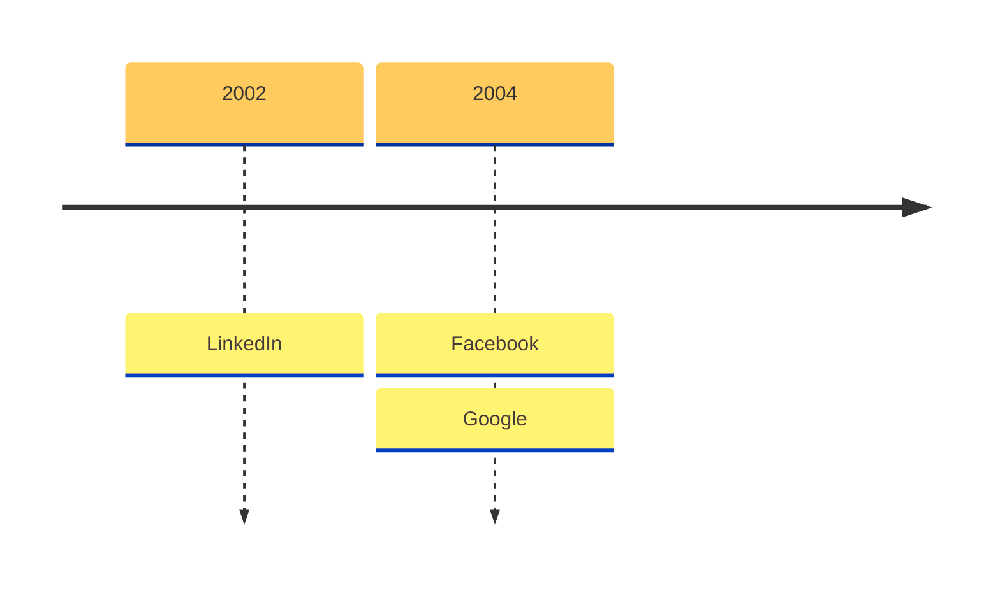
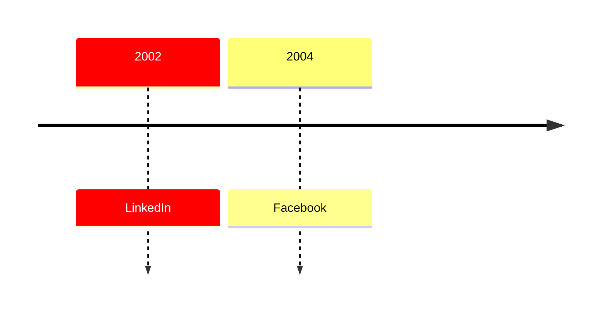
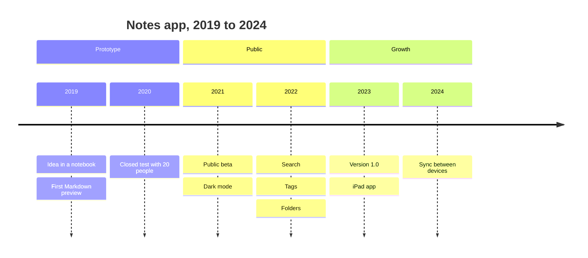

A Mermaid timeline starts with the word `timeline`, then lists one time period per line, each followed by a colon and one or more events. Put it in a fenced code block tagged `mermaid` and a Mermaid-aware preview draws it as a chain of periods with their events stacked underneath. It suits history, release notes and roadmaps where only the order matters. When you need real dates and durations, use a Gantt chart instead. This post covers the timeline syntax only; the other diagram types are in [Mermaid in Markdown](/blog/mermaid-diagrams-in-markdown/).

## The smallest timeline

````markdown

````

The pieces are:

- `timeline` on the first line chooses the diagram type.
- `title` is optional and sets the heading above the chart.
- Each other line is `time period : event`.

The Mermaid documentation says time periods and events are plain text, not limited to numbers, so `2021`, `Q3`, `Week 2` and `Before launch` are all valid. The first period appears at the left and the last at the right. Inside one period, the first event is at the top and the last at the bottom.

## One period, several events

There are two ways to attach more than one event to a period. Chain them on one line with extra colons, or continue on the next lines with a leading colon:

````markdown

````

Both forms give one column with three events. The continuation form is easier to edit once a period has more than two events.

## Sections

`section` followed by a name groups the periods below it, until the next `section` line. Periods and events in the same section share a colour. Periods written before any section go into a default section.

````markdown

````

Without sections, each period and its events get their own colour; with sections, colour marks the phase. The documentation says up to 12 sections get distinct colours and after that the colours repeat.

## Text wrapping and line breaks

Long periods and events wrap on their own so the text stays inside its box. To choose where a line breaks, write `<br>`:

````markdown

````

The documentation's examples use `<br>` in section names and in events.

## Direction

Add `LR` or `TD` after `timeline` to set the direction. `LR`, left to right, is the default. `TD` stacks the periods top to bottom, which reads better on a narrow screen or when you have many periods:

````markdown

````

The documentation marks direction as available from Mermaid v11.14.0. The Mermaid bundled in MiaoYan V4.9.0 is 11.14.0, and its timeline parser has rules for both `timeline LR` and `timeline TD`, so the keyword works there. An older Mermaid, for example the one in an older preview tool, will fail on it.

## Colour and theme options

Three things change how a timeline is coloured.

**One colour for everything.** Set `timeline.disableMulticolor` to `true` and every period and event uses a single colour scheme. Mermaid's own example puts it in a frontmatter block at the top of the diagram:

````markdown

````

The option is spelled `disableMulticolor` in the config example; the prose on the same page writes `disableMultiColor`, and the config spelling is the one the code uses. The bundled 11.14.0 reads `timeline?.disableMulticolor`.

**Custom section colours.** The theme variables `cScale0` to `cScale11` set background colours for sections or periods, and `cScaleLabel0` to `cScaleLabel11` set the matching text colours. Both appear in the bundled version. Set them under `themeVariables` in the same `config` block:

````markdown

````

**Themes.** The current documentation lists `default`, `neutral`, `dark`, `forest`, `base`, `neo`, `neo-dark`, `redux`, `redux-dark`, `redux-color` and `redux-dark-color`, with `redux-color` as the default. The bundled 11.14.0 contains the redux themes as well, but the docs page is written for Mermaid 12.3.0, so check a theme against your own preview before relying on it. MiaoYan's preview configures Mermaid with the `neutral` theme in light mode and `dark` in dark mode, and passes its own theme variables, so a frontmatter `theme` or `themeVariables` block can give different colours there than in Mermaid's examples. Check the diagram in both light and dark mode before relying on a colour.

## A worked example: a product history

````markdown

````

Three sections keep the colours meaningful, continuation lines keep each year easy to edit, and each event is a short phrase. A timeline like this works as a one-screen summary above a longer changelog.

## Timeline or Gantt

Use a timeline when the question is "what happened, and in what order". Periods are labels in the order you wrote them, not points on a scale.

Use a Gantt chart when the question is "how long, and what overlaps". A Gantt task has a start, an end or a duration, and the bars show overlap and dependencies with `after <id>`. A history of a product belongs in a timeline; a release schedule with owners and deadlines belongs in a Gantt chart. Both are covered with copy-ready blocks in [Mermaid in Markdown](/blog/mermaid-diagrams-in-markdown/).

## How the parser reads a line

Knowing the lexer rules explains most errors. In the bundled 11.14.0 the parser treats text as follows:

- A line starting with `title ` or `section ` takes the rest of the line. A `section` name cannot contain a colon.
- An event starts with a colon followed by whitespace, and runs until the next colon followed by whitespace or the end of the line. A colon not followed by a space stays in the text, so `10:30` is safe inside an event.
- A time period is any text up to the first colon, and cannot contain `#`.
- A line starting with `#` is a comment, and so is `%%`.

## Common errors

- **The block stays as code.** Syntax errors make MiaoYan keep the fenced source in place instead of showing an error, so an unrendered block means something is wrong. Check the first word is `timeline` and the fence tag is exactly `mermaid`.
- **An event splits in two.** A colon followed by a space inside an event text starts a new event. Write `Launch - beta` or put the colon without a space.
- **No space after the event colon.** The event rule needs whitespace after the colon and no other rule accepts a bare colon, so `2021 :Beta` fails while `2021 : Beta` works.
- **`timeline TD` fails.** The renderer is older than 11.14.0, or the word after `timeline` is neither `LR` nor `TD`.
- **Colours repeat.** The documentation says colours repeat after 12 sections.

To test, type `/mermaid` and press `Tab` in MiaoYan to insert a template, replace its body with a timeline, then press `⌘3` for the preview or `⌘\` for split view. Mermaid runs from the bundled script, so this works offline. Exported PDF and HTML come from the preview; see [Markdown to PDF on Mac](/blog/markdown-to-pdf-mac/) for page breaks, and [Markdown to slides](/blog/markdown-to-slides/) if the timeline is going into a deck. MiaoYan is on the [App Store](https://apps.apple.com/app/id6759252269) and its source is at [github.com/tw93/MiaoYan](https://github.com/tw93/MiaoYan).

## FAQ

### Is the Mermaid timeline experimental?

The current documentation page does not label it experimental, and says timeline loads on demand with no extra setup. Direction support is newer, from v11.14.0.

### Can a timeline use real dates?

The periods are plain text, so you can write `2021-11-02`, but Mermaid does not treat them as dates and does not space them by elapsed time. For scaled dates use a Gantt chart.

### How many events can one period have?

The docs set no limit. In practice more than four or five make a tall column, so split the period or use `timeline TD`.
