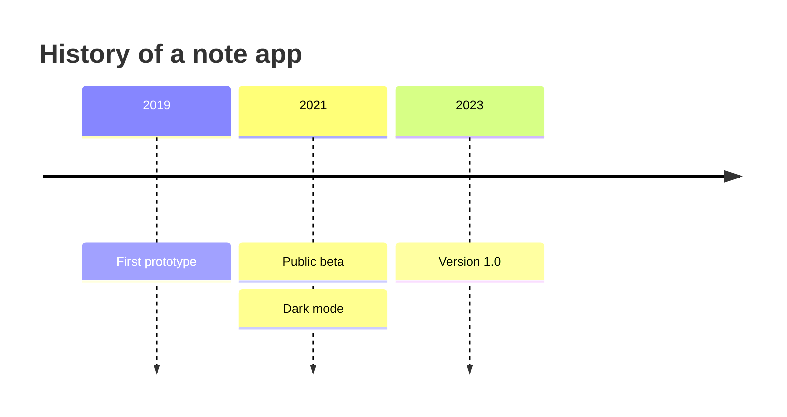
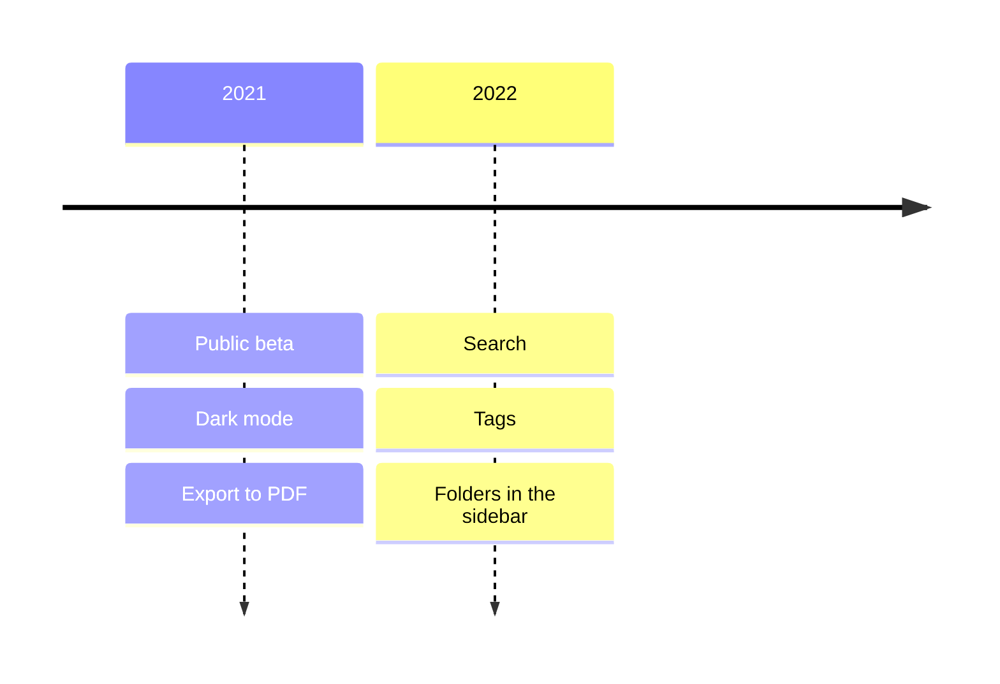
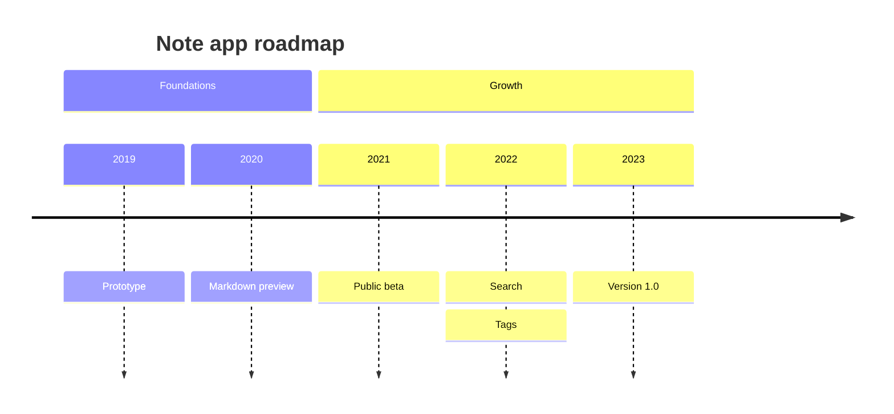
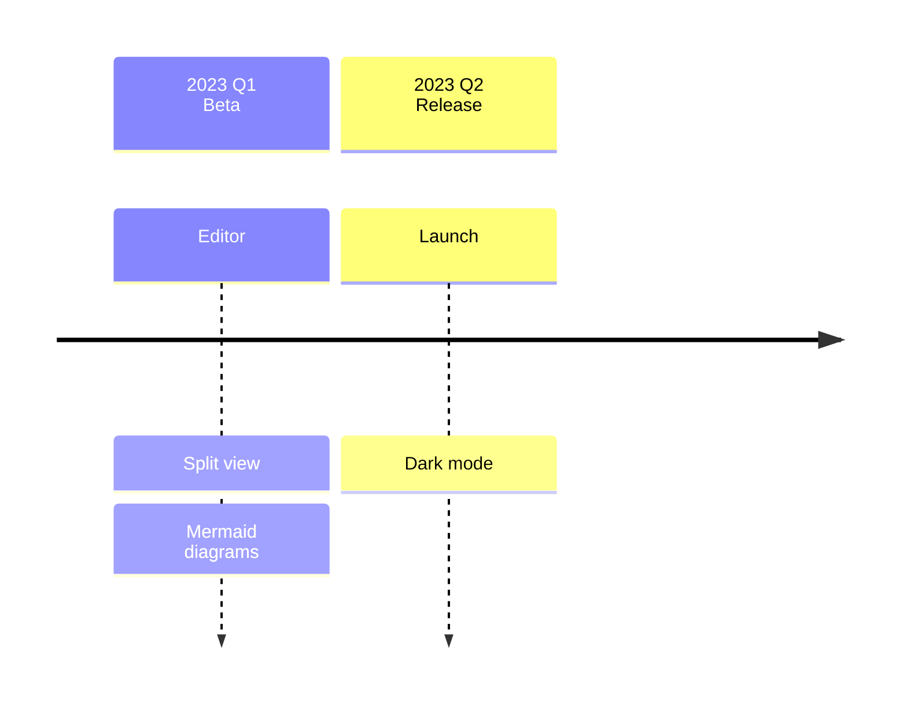
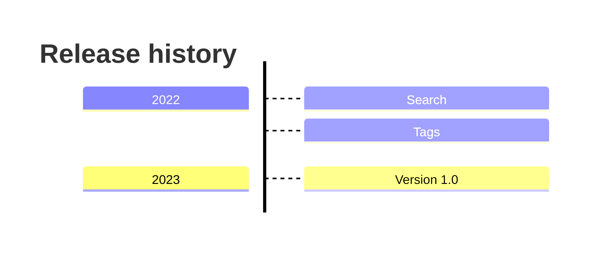
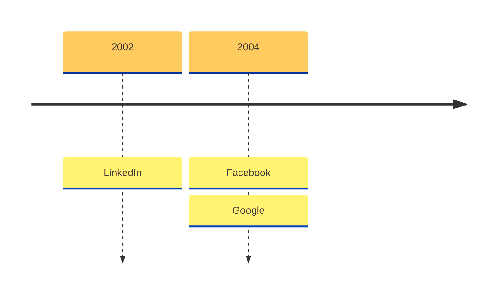
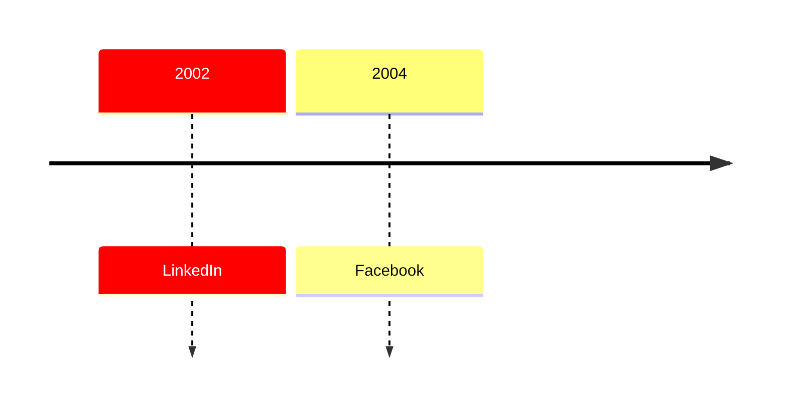
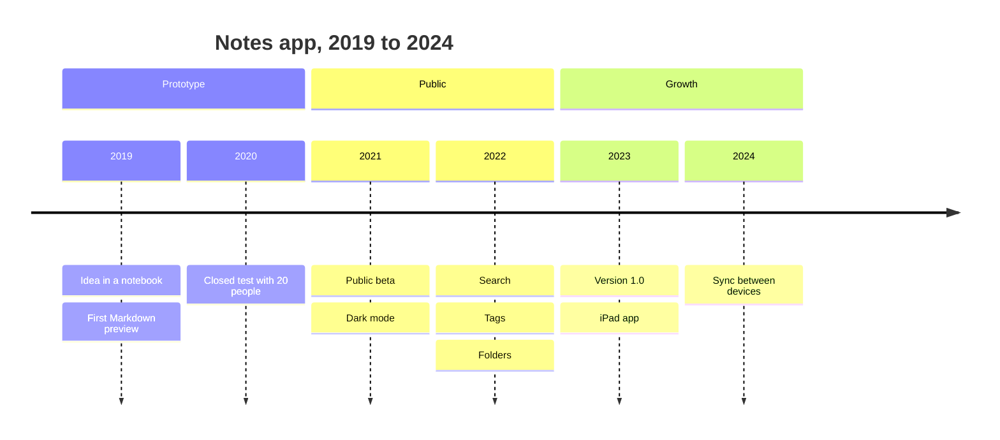

Mermaid 时间线以 `timeline` 开头，之后每行写一个时间段，后面跟冒号和一个或多个事件，放进语言名为 `mermaid` 的围栏代码块，支持 Mermaid 的预览就会把它画成一串时间段，事件叠在各自下方。它适合产品历史、版本记录、路线图这类只关心先后顺序的内容，需要真实日期和时长的时候改用甘特图。这篇只讲时间线的语法，其他图类型在 [Markdown 里画 Mermaid 图](/zh/blog/mermaid-diagrams-in-markdown/)里。

## 最小的时间线

````markdown

````

组成部分只有三样，第一行的 `timeline` 指定图类型，`title` 可写可不写，是图上方的标题，其余每行都是 `时间段 : 事件`。

Mermaid 文档说时间段和事件都是普通文字，不限于数字，所以 `2021`、`Q3`、`第二周`、`发布前` 都可以。第一个时间段在最左边，最后一个在最右边，同一个时间段里第一个事件在最上面，最后一个在最下面。

## 一个时间段挂多个事件

有两种写法，一种是在同一行用多个冒号串起来，另一种是换行后以冒号开头接着写。

````markdown

````

两种写法得到的都是一列三个事件，一个时间段超过两个事件以后，换行续写更好改。

## 分组 section

`section` 后面写名字，就把它下面的时间段归成一组，直到下一个 `section` 为止，同组的时间段和事件共用一种颜色，写在所有 `section` 之前的时间段进默认分组。

````markdown

````

不分组的时候每个时间段连同它的事件各用一种颜色，分组以后颜色表示阶段。文档说最多 12 个分组有不同的颜色，超过以后颜色会重复。

## 换行和自动折行

过长的时间段和事件会自动折行，保证文字留在框里，想自己决定在哪里断行就写 `<br>`。

````markdown

````

文档的示例在分组名和事件里用了 `<br>`。

## 排列方向

在 `timeline` 后面加 `LR` 或 `TD` 指定方向，`LR` 是从左到右，也是默认值，`TD` 把时间段从上往下排，窄屏或者时间段很多的时候更好读。

````markdown

````

文档标注方向支持从 Mermaid v11.14.0 开始。妙言 V4.9.0 自带的 Mermaid 正是 11.14.0，它的时间线解析规则里有 `timeline LR` 和 `timeline TD` 两条，所以能用，更旧的 Mermaid 会报错。

## 颜色和主题

影响时间线配色的有三样。

**全部一种颜色。** 把 `timeline.disableMulticolor` 设为 `true`，所有时间段和事件就共用一套配色，Mermaid 自己的例子是把它写在图顶部的 frontmatter 里。

````markdown

````

这个选项在配置示例里拼成 `disableMulticolor`，同一页的正文写成了 `disableMultiColor`，以代码里的写法为准，自带的 11.14.0 读取的也是 `timeline?.disableMulticolor`。

**自定义分组颜色。** 主题变量 `cScale0` 到 `cScale11` 设置分组或时间段的背景色，`cScaleLabel0` 到 `cScaleLabel11` 设置对应的文字颜色，两组变量在自带版本里都有，写在同一个 `config` 块的 `themeVariables` 下面。

````markdown

````

**主题。** 当前文档列出的有 `default`、`neutral`、`dark`、`forest`、`base`、`neo`、`neo-dark`、`redux`、`redux-dark`、`redux-color` 和 `redux-dark-color`，默认是 `redux-color`。自带的 11.14.0 里也有 redux 系列主题，但文档页对应的是 Mermaid 12.3.0，用某个主题之前最好在自己的预览里试一下。妙言的预览给 Mermaid 的配置在浅色下是 `neutral` 主题、深色下是 `dark`，还会传入自己的主题变量，所以图里写的 `theme` 或 `themeVariables` 在妙言里出来的颜色可能和 Mermaid 的示例不一样，要依赖某个颜色之前，在浅色和深色下各看一遍。

## 一个产品历史的例子

````markdown

````

三个分组让颜色有意义，换行续写让每一年都好改，每个事件都是一个短语，这样的时间线放在一份长的更新记录上面，当一屏的摘要用就很合适。

## 时间线还是甘特图

问题是「发生了什么、先后顺序是什么」的时候用时间线，时间段只是按书写顺序排的标签，不是刻度上的点。

问题是「持续多久、哪些重叠」的时候用甘特图，每个任务有起点、终点或时长，条形能表现重叠，`after <id>` 能表现依赖。产品的历史适合时间线，带负责人和截止日的发布排期适合甘特图，两种图的可复制示例都在 [Markdown 里画 Mermaid 图](/zh/blog/mermaid-diagrams-in-markdown/)里。

## 解析器怎么读一行

了解词法规则能解释大部分错误，自带 11.14.0 的解析器是这样处理文本的。

- 以 `title ` 或 `section ` 开头的行，取这一行剩下的全部，`section` 的名字里不能有冒号。
- 事件以冒号加空白开头，到下一个冒号加空白或行尾结束，冒号后面不跟空格就留在文字里，所以事件里写 `10:30` 是安全的。
- 时间段是第一个冒号之前的任意文字，不能包含 `#`。
- 以 `#` 或 `%%` 开头的行是注释。

## 常见错误

- **块一直显示成代码。** 语法有错时妙言会把围栏里的源码原样留着，不显示报错，所以没渲染出来就是哪里写错了，先看第一个词是不是 `timeline`，围栏的语言名是不是正好 `mermaid`。
- **一个事件被拆成两个。** 事件文字里出现冒号加空格就会开始新事件，可以写成 `Launch - beta`，或者冒号后面不留空格。
- **事件冒号后没有空格。** 事件规则要求冒号后有空白，别的规则也不接受单独的冒号，所以 `2021 :Beta` 会失败，`2021 : Beta` 可以。
- **`timeline TD` 报错。** 渲染器比 11.14.0 旧，或者 `timeline` 后面的词既不是 `LR` 也不是 `TD`。
- **颜色重复。** 文档说超过 12 个分组以后颜色会重复。

测试的话，在妙言里输入 `/mermaid` 再按 `Tab` 插入模板，把内容换成时间线，按 `⌘3` 看预览或者按 `⌘\` 打开分栏，Mermaid 跑的是随应用打包的脚本，所以离线也能用。导出的 PDF 和 HTML 都来自预览，分页见[在 Mac 上把 Markdown 转成 PDF](/zh/blog/markdown-to-pdf-mac/)，时间线要放进演示文稿的话见 [Markdown 转幻灯片](/zh/blog/markdown-to-slides/)。妙言在 [App Store](https://apps.apple.com/app/id6759252269) 上，源码在 [github.com/tw93/MiaoYan](https://github.com/tw93/MiaoYan)。

## 常见问题

### Mermaid 时间线是实验功能吗？
当前文档页没有把它标成实验性，并且说时间线按需加载，不用额外设置，方向支持是较新的，从 v11.14.0 开始。

### 时间线能用真实日期吗？
时间段是普通文字，可以写 `2021-11-02`，但 Mermaid 不会把它当日期，也不会按间隔的长短排布，需要按刻度排日期就用甘特图。

### 一个时间段最多几个事件？
文档没有写上限，实际上超过四五个就会变成一根高柱子，可以拆开时间段或者用 `timeline TD`。
