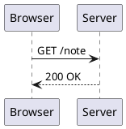
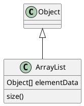
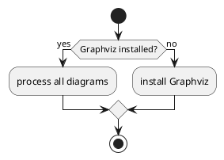

To draw a UML diagram in Markdown, write PlantUML text between `@startuml` and `@enduml` inside a fenced code block tagged `plantuml`. MiaoYan turns that block into an image, but not on your Mac: in V4.5.0 the preview encodes the diagram text into a URL and loads the picture from the public server at `www.plantuml.com`. The diagram renders only with a network connection, and the text of every PlantUML block you preview is sent to that server. For private diagrams, use Mermaid in the same note, or render locally with PlantUML itself and insert the resulting SVG.

## Syntax

````markdown

````

`->` draws a solid arrow and `-->` a dotted one, the usual way to show a reply, as in the PlantUML sequence diagram page (`Alice -> Bob: Authentication Request` and `Bob --> Alice: Authentication Response`). Participants can be declared first to fix their order, with keywords such as `participant` and `actor`. Groups use `alt`, `else` and `end`.

### Class diagrams

````markdown

````

`<|--` draws inheritance, and a line starting with a class name, a colon and a member adds that member to the class. `*--` and `o--` are composition and aggregation, as listed on the class diagram page.

### Activity diagrams

````markdown

````

In the newer activity syntax, `:text;` is one action, and `if (...) then (yes) ... else (no) ... endif` is a branch, with `start` and `stop` at the ends, as on the PlantUML activity diagram page. The `@startuml` and `@enduml` lines are part of PlantUML's own input, so keep them in the fence.

In MiaoYan you can type `/plantuml` and press `Tab`, or choose "/plantuml - UML Diagram" from the Tab Quick Input submenu of the Format menu. It inserts a two-participant sequence diagram with the message text selected; the placeholder text is in Chinese.

## How MiaoYan renders it

A `plantuml` fence reaches the preview as a code element with the class `language-plantuml`. The preview script (`diagram-handler.js`) does these steps for each one:

1. Reads the text of the block.
2. Deletes every `skinparam` directive, from the word to the end of its line, then prepends its own set of `skinparam` lines for background, text color, actors, participants, classes, arrows and more, chosen for light or dark appearance.
3. Compresses and encodes the result with a bundled copy of the `plantuml-encoder` library.
4. Creates an `img` element whose source is `https://www.plantuml.com/plantuml/svg/~1` followed by the encoded text, and hides the code block.

[[figure:plantuml-in-markdown|A plantuml fence is read by the preview script, encoded into a URL, and requested from the public plantuml.com server, which returns an SVG; if the request fails the source code is shown.|The diagram text leaves your Mac inside the image URL, and only the returned SVG comes back.]]

The URL is hardcoded in the preview script, and there is no setting to change it, so you cannot point the preview at your own server. Step 2 has two practical consequences. Your own `skinparam` lines are discarded, so you cannot restyle a diagram from inside the note. And because the removal works line by line, a multi-line `skinparam` block with braces loses its first line and keeps the rest, and the server answers with a syntax error picture, so avoid that form in MiaoYan.

## Privacy

The encoded text sits in the path of an ordinary HTTPS request. PlantUML's encoding is Deflate compression plus a base64-like alphabet, not encryption, so the server can read your diagram in full, plus the usual request metadata such as your IP address, each time the preview renders it. Class names, service names, hostnames and the labels on arrows are all part of that text. PlantUML's server page says nothing about how long the public server keeps what it receives, so treat the content as shared with a third party.

PlantUML's server page also explains how to host the server yourself. What differs between apps is whether they let you choose the address. MiaoYan V4.5.0 does not.

## Running PlantUML locally

If a diagram should not leave your machine, render it yourself and embed the picture. PlantUML's command-line page documents:

````bash
java -jar plantuml.jar --svg diagram.puml
cat diagram.puml | java -jar plantuml.jar --svg -pipe > diagram.svg
````

Then reference `diagram.svg` as a normal image in the note. The cost is a manual step each time the diagram changes. PlantUML's server page describes deploying `plantuml.war` to Tomcat 10, lists the URL form `/plantuml/svg/ENCODED`, and mentions running the PicoWeb server locally. Those serve other tools that let you set the server address; MiaoYan's preview does not read such a setting. The command-line page also documents `java -jar plantuml.jar --check-graphviz` for checking a Graphviz install, which local rendering of some diagrams relies on.

## When Mermaid is the better choice

Mermaid runs from JavaScript bundled in the app, so it works offline. It covers flowcharts, sequence diagrams, class diagrams and Gantt charts, in the same note and fence mechanism. PlantUML's strengths are its long-standing UML coverage and the large number of existing `.puml` sources. If you have those sources, or need a diagram type Mermaid draws poorly, PlantUML is justified, with the privacy cost above. For new diagrams with no such need, start with Mermaid, covered in [Mermaid diagrams in Markdown](/blog/mermaid-diagrams-in-markdown/). The [Markdown cheat sheet](/blog/markdown-cheat-sheet/) lists the fence names for all the diagram languages.

## What goes wrong, and export

- **"Failed to load diagram" and then the source.** The server was unreachable, or you are offline. The message shows for about two seconds, then the preview shows the code block again.
- **A black PlantUML error picture.** A syntax mistake comes back from the server as an error picture instead of the diagram. It quotes your text with MiaoYan's `skinparam` lines on top, and the line number it reports counts those lines too, so look at the quoted text rather than the number. Check the `@startuml` and `@enduml` lines, unbalanced quotes, and arrows.
- **Colors are not what you wrote.** Your `skinparam` lines were removed, as described above.
- **The diagram appears late.** The image loads from the network after the page renders, so slow connections show the loading state for a moment.
- **Export.** For PDF export, MiaoYan waits until every image on the page has loaded, PlantUML images included, for up to about ten seconds, then prints anyway. Offline, the export contains the code block instead of the picture, so check an exported file once.

To confirm the behavior, insert the template, preview it with a connection, then turn Wi-Fi off, reload the preview and see the code block return.

## FAQ

### Does PlantUML work offline in MiaoYan?

No. The picture comes from `www.plantuml.com`, so without a connection you see the source text instead.

### Can I use my own PlantUML server in MiaoYan?

Not in V4.5.0. The address is fixed in the preview script.

### Which diagrams should I keep off the public server?

Anything with internal service names, customer data, or unreleased architecture. Use Mermaid or a locally rendered SVG for those.
