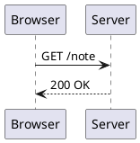
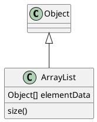
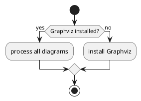

想在 Markdown 里画 UML 图，做法是在语言名为 `plantuml` 的围栏代码块里，把 PlantUML 文本写在 `@startuml` 和 `@enduml` 之间。妙言会把这个块变成图片，但不是在你的 Mac 上画的，V4.5.0 的预览会把图的文字编码进一个网址，再从 `www.plantuml.com` 这个公共服务器加载图片。所以它必须联网才能显示，而且每个预览过的 PlantUML 块的文字都会发到那台服务器。图如果是私密的，可以在同一篇笔记里改用 Mermaid，或者用 PlantUML 自己在本地渲染，再把生成的 SVG 插进笔记。

## 写法

````markdown

````

`->` 画实线箭头，`-->` 画虚线箭头，一般用来表示回复，PlantUML 时序图文档里的例子就是 `Alice -> Bob: Authentication Request` 和 `Bob --> Alice: Authentication Response`。可以先用 `participant`、`actor` 这类关键字声明参与者来固定顺序，分组用 `alt`、`else` 和 `end`。

### 类图

````markdown

````

`<|--` 表示继承，以类名、冒号和成员开头的一行会把这个成员加到类里，`*--` 和 `o--` 分别是组合和聚合，这些都列在类图文档页里。

### 活动图

````markdown

````

新版活动图语法里，`:文字;` 是一个动作，`if (...) then (yes) ... else (no) ... endif` 是分支，两头用 `start` 和 `stop`，写法和 PlantUML 活动图文档页一致。`@startuml` 和 `@enduml` 是 PlantUML 自己的输入格式，围栏里要保留。

妙言里可以输入 `/plantuml` 再按 `Tab`，也可以在「格式」菜单的「Tab快捷输入」子菜单里选 `/plantuml` 那一项，会插入一个两个参与者的时序图，消息文字处于选中状态，占位文字是中文。

## 妙言是怎么渲染的

`plantuml` 围栏到达预览时是一个类名为 `language-plantuml` 的 code 元素，预览脚本（`diagram-handler.js`）对每一个按下面几步处理：

1. 读取块里的文字。
2. 删掉所有 `skinparam` 指令，从这个词一直删到行尾，再在前面加上自己的一组 `skinparam`，涵盖背景、文字颜色、角色、参与者、类、箭头等，按浅色或深色外观选择。
3. 用打包的 `plantuml-encoder` 库压缩并编码结果。
4. 创建一个 `img` 元素，地址是 `https://www.plantuml.com/plantuml/svg/~1` 加上编码后的文字，同时隐藏代码块。

[[figure:plantuml-in-markdown|plantuml 代码块由预览脚本读出、编码进网址，向公共的 plantuml.com 服务器请求 SVG，请求失败时显示源码。|图的文字会随图片网址发到 plantuml.com，回来的只有渲染好的 SVG，请求失败时预览回退成源码。]]

这个网址写死在预览脚本里，没有设置可以改，所以没法把预览指向你自己的服务器。第 2 步带来两个实际后果，一是你自己写的 `skinparam` 会被丢掉，没法在笔记里给图改样式；二是删除是逐行进行的，带花括号的多行 `skinparam` 块会丢掉第一行而留下其余部分，服务器随之返回一张语法错误图，所以在妙言里避免这种写法。

## 隐私

编码后的文字放在一个普通 HTTPS 请求的路径里，PlantUML 的编码只是 Deflate 压缩加一套类似 base64 的字符表，不是加密。所以每次预览渲染时，服务器都能读到你的图内容，外加你的 IP 地址这类常规请求信息，类名、服务名、主机名和箭头上的标签都在这段文字里。PlantUML 的服务器页面没有说公共服务器会把收到的内容保留多久，所以应当把内容视为已经共享给了第三方。

PlantUML 的服务器页面也讲了怎么自己部署服务器，各家应用的区别在于是否允许你选择地址，妙言 V4.5.0 不允许。

## 在本地运行 PlantUML

图不应该离开你的电脑时，就自己渲染再嵌入图片。PlantUML 命令行文档里写的是：

````bash
java -jar plantuml.jar --svg diagram.puml
cat diagram.puml | java -jar plantuml.jar --svg -pipe > diagram.svg
````

然后把 `diagram.svg` 当普通图片引用到笔记里，代价是图每改一次就要手动再跑一遍。PlantUML 的服务器文档还提到可以把 `plantuml.war` 部署到 Tomcat 10，地址形式是 `/plantuml/svg/ENCODED`，也提到可以在本机跑 PicoWeb 服务器，这些适合允许设置服务器地址的工具，妙言的预览不读这样的设置。命令行文档里还写了 `java -jar plantuml.jar --check-graphviz` 用来检查 Graphviz 是否安装，部分图在本地渲染时要用到它。

## 什么时候 Mermaid 更合适

Mermaid 跑的是应用里打包的 JavaScript，离线可用，它覆盖流程图、时序图、类图和甘特图，和 PlantUML 一样放在笔记的围栏里。PlantUML 的长处是长年积累的 UML 覆盖，以及手上已有大量 `.puml` 源文件。如果你有这些源文件，或者需要 Mermaid 画不好的图类型，用 PlantUML 是有道理的，只是要接受上面的隐私代价。没有这类需求的新图，先用 Mermaid，见 [Markdown 里画 Mermaid 图](/zh/blog/mermaid-diagrams-in-markdown/)；各种图表语言的围栏名在 [Markdown 语法速查与 GFM 差异](/zh/blog/markdown-cheat-sheet/) 里列了出来。

## 常见问题与导出

- **显示「Failed to load diagram」然后变回源码。** 服务器连不上，或者你处于离线状态，这行提示显示两秒左右，预览随后重新显示代码块。
- **一张黑底的 PlantUML 报错图。** 语法错误时服务器返回的是报错图而不是正常的图，图里引用的文字上面带着妙言加的 `skinparam`，报出来的行号也把这些行算了进去，所以看引用的文字，别按行号找。先检查 `@startuml` 和 `@enduml` 两行、引号是否成对以及箭头写法。
- **颜色和你写的不一样。** 你写的 `skinparam` 行已被删除，原因见上面。
- **图出现得晚。** 图片是页面渲染后从网络加载的，网速慢的时候会先显示一会儿加载状态。
- **导出。** 导出 PDF 时，妙言会等页面上所有图片加载完再打印，其中包括 PlantUML 的图片，最多等十秒左右，超时照样打印，离线时导出文件里是代码块而不是图，所以导出以后看一次文件。

验证的办法是插入模板，联网预览一次，再关掉 Wi-Fi，重新加载预览，看代码块回来。

## 常见问题

### 妙言里的 PlantUML 能离线用吗？

不能，图片来自 `www.plantuml.com`，没有网络时看到的是源文本。

### 妙言里能用自己的 PlantUML 服务器吗？

V4.5.0 里不能，地址写死在预览脚本里。

### 哪些图不该发到公共服务器？

带内部服务名、客户数据或未发布架构的图，这些用 Mermaid 或本地渲染的 SVG。
