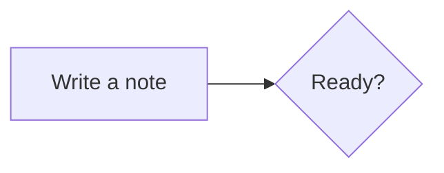

## Put the diagram in a Markdown note

Copy Markdown wraps your code in a fenced block tagged `mermaid`:

````markdown

````

Paste that into a note and a Mermaid-aware preview draws it: MiaoYan, GitHub, GitLab, Obsidian and Typora all read this block. Each diagram type has its own syntax, written up with examples in [flowcharts](/blog/mermaid-flowchart/), [sequence diagrams](/blog/mermaid-sequence-diagram/), [timelines](/blog/mermaid-timeline/), [Gantt charts](/blog/mermaid-gantt-chart/), [class diagrams](/blog/mermaid-class-diagram/) and [ER diagrams](/blog/mermaid-er-diagram/), and the overview is [Mermaid in Markdown](/blog/mermaid-diagrams-in-markdown/).

## FAQ

### Is it free?

Yes, and there is no account. The diagram is drawn in your browser, and a copied link carries the whole diagram inside the link itself.

### Which Mermaid version does it use?

Mermaid 11.14.0 with MiaoYan's diagram colours, the same file the MiaoYan app bundles, so a diagram drawn here looks the same in a note. Labels are drawn as SVG text so that a downloaded file reads the same on every computer.

### How do I export a diagram?

Download PNG saves an image at twice the size on a light background, ready for slides and documents. Download SVG keeps it as a vector that stays sharp at any size and opens in Figma, Sketch or Illustrator.

### Why did the diagram stop updating?

When the code has a mistake, the last working diagram stays, faded, and Mermaid's message appears under the editor with the line it stopped at. Common causes are a lowercase `end` as a flowchart node, a missing colon in a timeline, and a diagram type that Mermaid 11.14.0 does not know.

### Where is my diagram kept?

The editor keeps your last diagram in this browser, so it is still there when you come back. Copy link puts the code into the link, so whoever opens it sees the same diagram.
