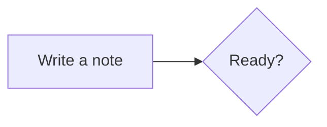

## Put the diagram in a Markdown note

Copy Markdown wraps your code in a fenced block tagged `mermaid`:

````markdown

````

Paste that into a note and a Mermaid-aware preview draws it: MiaoYan, GitHub, GitLab, Obsidian and Typora all read this block. Each diagram type has its own syntax, written up with examples in [flowcharts](/blog/mermaid-flowchart/), [sequence diagrams](/blog/mermaid-sequence-diagram/), [timelines](/blog/mermaid-timeline/), [Gantt charts](/blog/mermaid-gantt-chart/), [class diagrams](/blog/mermaid-class-diagram/) and [ER diagrams](/blog/mermaid-er-diagram/), and the overview is [Mermaid in Markdown](/blog/mermaid-diagrams-in-markdown/).

## FAQ

### Which diagrams can I draw?

The templates cover flowcharts, sequence diagrams, timelines, Gantt charts, class, state and ER diagrams, pie charts, mind maps and XY charts; picking one and editing its example is the quickest start, and any other type Mermaid knows can be written by hand. It runs Mermaid 11.14.0, the same file and colours the MiaoYan app bundles, so a diagram drawn here looks the same in a note.

### Is the downloaded image sharp enough?

PNG is exported at twice the size on MiaoYan's light diagram background, scaled down a little for a very large diagram so the image stays within 16 million pixels, and Copy image puts that same PNG on the clipboard for pasting into a chat or a document. For something you can enlarge without blur, download the SVG, whose labels are SVG text that other apps display as it is.

### How do I send a diagram to someone?

Copy link compresses the code into the link itself, so whoever opens it sees the same diagram. Nothing is stored on a server, and neither of you needs an account.

### Why did the diagram stop updating?

When the code has a mistake, the last working diagram stays, faded, Mermaid's message appears under the editor, and the line it stopped at is marked beside the code. Common causes are a lowercase `end` as a flowchart node, a missing colon in a timeline, and a diagram type that Mermaid 11.14.0 does not know.
