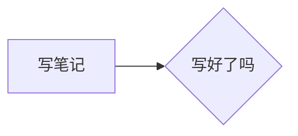

## 把图放进 Markdown 笔记

复制 Markdown 会把代码包进语言名为 `mermaid` 的围栏代码块：

````markdown

````

把它贴进笔记，支持 Mermaid 的预览就会把图画出来，妙言、GitHub、GitLab、Obsidian 和 Typora 都认这种代码块。每种图的写法不一样，[流程图](/zh/blog/mermaid-flowchart/)、[时序图](/zh/blog/mermaid-sequence-diagram/)、[时间线](/zh/blog/mermaid-timeline/)、[甘特图](/zh/blog/mermaid-gantt-chart/)、[类图](/zh/blog/mermaid-class-diagram/) 和 [ER 图](/zh/blog/mermaid-er-diagram/) 各有一篇带示例的写法，总的介绍在 [Markdown 里画 Mermaid 图](/zh/blog/mermaid-diagrams-in-markdown/)。

## 常见问题

### 能画哪些图？

模板里有流程图、时序图、时间线、甘特图、类图、状态图、ER 图、饼图、思维导图和 XY 图表，点一个换成它的示例再改最快，模板里没有的类型照着 Mermaid 的写法直接写也能画。用的是 Mermaid 11.14.0，和妙言 App 自带的是同一个文件，配色也一样，这里画好的图放进笔记里就是同一张。

### 下载的图片够清楚吗？

PNG 按两倍大小导出，底色是妙言图表的浅色背景，特别大的图会把倍数往下调一点，整张控制在 1600 万像素以内，复制图片拿到的也是这张 PNG，可以直接粘贴到聊天和文档里。要放大也不糊就下载 SVG，文字是 SVG 自己的文本，放进别的软件里也能正常显示。

### 怎么把图发给别人？

点复制链接，代码会压缩后写进链接里，对方打开就是这张图，图不存在服务器上，你和对方都不用注册。

### 图为什么不更新了？

代码写错时，上一张能画出来的图会留着并变淡，编辑器下面显示 Mermaid 的报错，出错的那一行在行号上标了出来。常见的原因是流程图里用了小写的 `end` 当节点名、时间线里少了冒号，或者用了 Mermaid 11.14.0 还不认识的图类型。
