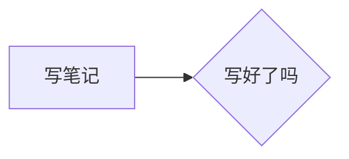

## 把图放进 Markdown 笔记

复制 Markdown 会把代码包进语言名为 `mermaid` 的围栏代码块：

````markdown

````

把它贴进笔记，支持 Mermaid 的预览就会把图画出来，妙言、GitHub、GitLab、Obsidian 和 Typora 都认这种代码块。每种图的写法不一样，[流程图](/zh/blog/mermaid-flowchart/)、[时序图](/zh/blog/mermaid-sequence-diagram/)、[时间线](/zh/blog/mermaid-timeline/)、[甘特图](/zh/blog/mermaid-gantt-chart/)、[类图](/zh/blog/mermaid-class-diagram/) 和 [ER 图](/zh/blog/mermaid-er-diagram/) 各有一篇带示例的写法，总的介绍在 [Markdown 里画 Mermaid 图](/zh/blog/mermaid-diagrams-in-markdown/)。

## 常见问题

### 要收费吗？

不收费，也不用注册账号，图就在你的浏览器里画，复制出来的链接里带着整张图。

### 用的是哪个版本的 Mermaid？

Mermaid 11.14.0，配妙言的图表配色，和妙言 App 自带的是同一个文件，所以这里画出来的图放进笔记里也是一样的。文字用 SVG 文本来画，下载下来的文件换到别的电脑上打开也一样。

### 怎么导出图片？

下载 PNG 会存一张两倍尺寸的浅色底图片，放进幻灯片和文档里刚好。下载 SVG 存的是矢量图，放多大都清晰，Figma、Sketch 和 Illustrator 都能直接打开再改。

### 图为什么不更新了？

代码写错时，上一张能画出来的图会留着并变淡，编辑器下面会显示 Mermaid 的报错和出错的行号。常见的原因是流程图里用了小写的 `end` 当节点名、时间线里少了冒号，或者用了 Mermaid 11.14.0 还不认识的图类型。

### 画的图存在哪？

编辑器会把你最后一次画的图留在这个浏览器里，下次打开还在。复制链接会把代码放进链接里，别人打开就是同一张图。
